# ShiftKD: Benchmarking Knowledge Distillation under Distribution Shift

> **출처:** Neural Networks, Vol. 192, Article 107838 (2025)   
> <strong>저자</strong><strong>:</strong> Songming Zhang, Yuxiao Luo, Ziyu Lyu, Xiaofeng Chen   
> **연도:** 2025   
> **논문:** https://www.sciencedirect.com/science/article/pii/S089360802500718X   
> **코드:** https://github.com/ZZhangsm/ShiftKD.git   

> 주석이 없는 그림과 표는 해당 논문의 그림과 표이다.

---

## 3줄 요약

1. 🔍 본 논문은 <strong>Knowledge Distillation(KD)이 실세계의 Distribution Shift(Diversity Shift 및 Correlation Shift) 환경에서 겪는 신뢰성 문제를 체계적으로 분석하기 위한 벤치마크 프레임워크</strong> 'ShiftKD'를 제안
2. 🛠️ 30개 이상의 KD 알고리즘, 데이터 증강 및 가지치기 기법, 최적화 전략을 포함하는 광범위한 실험을 통해, 기존 KD 방법론들이 Distribution Shift 상황에서 성능 저하를 겪는 <strong>원인을 알고리즘, 데이터, 최적화 측면</strong>에서 다각도로 검증
3. 📊 실험 결과,<strong> 기존의 복잡한 KD 모델들이 항상 vanilla KD보다 우수한 것은 아니며</strong>, <strong>학생 모델의 강건성은 교사 모델의 편향 및 데이터의 질에 크게 의존함</strong>을 밝혀내어 향후 더 강건한 KD 방법론 개발을 위한 실증적 지침을 제공

---

>
> ## 구현·재현 지도
>
> * **Novelty :** <strong>Distribution Shift 환경에서 기존 KD 방법들의 일반화 성능과 한계를 체계적으로 평가하는 Benchmark Framework</strong> 제안
>   → 기존 KD 연구는 주로 i.i.d. 상황(학습 분포와 Test 분포가 동일)을 가정하고, Teacher의 지식을 Student에게 얼마나 효과적으로 전달하는지 연구한다. 하지만 실제 KD 문제는 2가지 문제로 이루어져 있다.
> 	1. <strong>Model Compression</strong> : 큰 Teacher의 지식을 작은 Student에게 전달 → 기존 KD 방법의 초점
> 	2. <strong>Distribution Shift</strong> : i.i.d. 가정과 다르게 실제 환경에서는 Distribution이 달라지면서 Student의 일반화 성능이 감소할 수 있다. → 저자들은 이 상황에서 기존 방법들이 여전히 유효한지에 대해 연구
>
>   **3가지 Research Question(RQ)**
> 	- <strong>RQ1. 기존 KD 알고리즘이 Distribution Shift에서도 효과적인가?</strong>
> 	- <strong>RQ2. Data Augmentation과 Data Pruning이 Student의 Robustness를 개선하는가?</strong>
> 	- <strong>RQ3. Hyperparameter, Pre-training, Optimizer 등의 학습 설정은 어떤 영향을 미치는가?</strong>
>
>   **주요 Contribution**
> 	- Distribution Shift를 고려한 <strong>KD 문제를 Multi-domain Learning Setting으로 재정의</strong>
> 	- <strong>Diversity Shift와 Correlation Shift를 구분</strong>하고, 5개 Dataset에서 30개 이상의 방법 및 설정을 평가
> 	- <strong>Algorithm, Data, Optimization이라는 세 관점</strong>에서 KD의 효과를 비교
> 	- 평균 성능뿐 아니라 <strong>Worst-case 성능을 평가</strong>하여 기존 KD의 한계를 분석
>
> * **구조** 학습 데이터의 Source Domain만 사용하여 Teacher와 Student를 학습 후, Target Domain은 모델 선택에 사용하지 않고 최종 평가 대상으로 사용한다.
>   
>   - **Teacher Training** : Source Domain을 이용하여 Teacher 학습
>   - **Student Distillation** : Teacher의 지식과 Ground-truth Label을 이용하여 Student 학습
>   - **Model Selection** : Source Domain의 Validation Accuracy를 기준으로 모델 선택
>   - **Evaluation** : 학습에서 제외한 Unseen Target Domain에서 Student의 일반화 성능 평가
>
> * **핵심 수식**
> 	* 기존 KD의 목적 함수
> 	  $$
> 	  \min_{\theta_s}\mathbb{E}\left[\alpha\mathcal L_{\mathrm{KL}}(S,T)+(1-\alpha)\mathcal L_{\mathrm{CE}}(S,Y)\right]\tag{1}
> 	  $$
> 	* Distribution Shift 환경에서 평가하는 KD의 공통 목적 함수 : 이때 $\mathcal L_{\mathrm{reg}}$는 각 KD 방법이 추가적으로 전달하는 Knowledge에 대한 Loss이며, 기존 KD 알고리즘을 통합적으로 비교하기 위한 Loss일 뿐이다.
> 	  $$
> 	  \min_{\theta_s}\mathbb E\left[\alpha\mathcal L_{\mathrm{KL}}(S,T)+(1-\alpha)\mathcal L_{\mathrm{CE}}(S,Y)+\beta\mathcal L_{\mathrm{reg}}\right]\tag{2}
> 	  $$
>
>   **Distribution Shift의 두 유형**
>   - <strong>Diversity Shift</strong> : Domain의 스타일과 특성이 바뀌는 상황
>
>     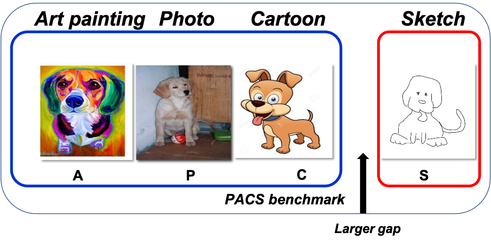
>     > https://dali-dl.github.io/project_iccv2017.html
>
>   - <strong>Correlation Shift</strong> : Label과 Spurious Feature의 상관관계가 바뀌는 상황
>
>     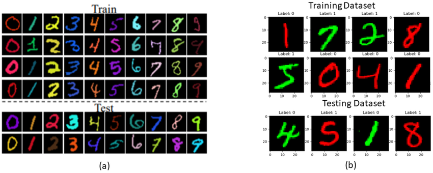
>     > https://www.researchgate.net/figure/Colored-MNIST-Training-and-Testing-Datasets-Examples-with-color-bias-a-Some-image_fig3_359598575
>
>   이를 Semantic Factor $S^e$, Variation Factor $V$를 이용해 설명한다. $S^e$는 Label을 결정하는 Semantic Information이고, $V$는 Style 등 변동하는 Context Feature이다.
>   
>   최종적으로 두 분포의 확률함수를 $\phi$, $\psi$라고 할 때, 논문에서는 다음과 같이 Shift를 정량화하는 식을 정의한다. 이때 $\mathcal V_1$은 두 환경의 Support가 겹치지 않는 부분, $\mathcal V_2$는 두 Support가 겹치는 부분이며, $F_{\mathrm{div}}$는 Support의 차이를 고려하고 $F_{\mathrm{cor}}$은 공유되는 Support에서 Conditional Label Distribution의 차이를 고려한다.
>
>   $$
>   F_{\mathrm{div}}(\phi,\psi)
>   =\frac12\int_{\mathcal V_1}|\phi(v)-\psi(v)|\,dv
>   \tag{4}
>   $$
>
>   $$
>   F_{\mathrm{cor}}(\phi,\psi)
>   =\frac12\int_{\mathcal V_2}
>   \sqrt{\phi(v)\psi(v)}
>   \sum_{y\in\mathcal Y}
>   |\phi(y\mid v)-\psi(y\mid v)|\,dv
>   \tag{5}
>   $$
>
>   단, 이 두 Shift Metric은 Distribution Shift를 설명하기 위한 것이며, KD 학습 과정에서 직접 최소화하는 Loss는 아니다.
>
> * **Data / 학습**
>
>   **Dataset 구성**
>
>   | Dataset | Domains | Classes | Shift |
>   |---|---:|---:|---|
>   | PACS | 4 | 7 | Diversity |
>   | OfficeHome | 4 | 65 | Diversity |
>   | DomainNet | 6 | 345 | Diversity |
>   | ColorMNIST | 3 | 2 | Correlation |
>   | CelebA-Blond | 3 | 2 | Correlation |
>
>   **Dataset별 Domain Index**
>
>   | Dataset | Domain Index |
>   |---|---|
>   | PACS | 0: Art, 1: Cartoon, 2: Photo, 3: Sketch |
>   | OfficeHome | 0: Art, 1: Clipart, 2: Product, 3: Real World |
>   | DomainNet | 0: Clipart, 1: Infograph, 2: Painting, 3: Quickdraw, 4: Real, 5: Sketch |
>   | ColorMNIST | 0: +90%, 1: +80%, 2: −90% |
>   | CelebA-Blond | 0: tr_env1, 1: tr_env2, 2: te_env |
>
>   **Data Split**
>   - Target Domain을 제외한 Source Domain에서 Train 80%, Validation 20%로 분할
>   - Target Domain은 학습 및 Model Selection에 사용하지 않고 최종 Evaluation에만 사용
>   - Diversity Shift에서는 각 Domain을 번갈아 Target Domain으로 지정하여 평가
>
>   **ColorMNIST 생성 방법 — Correlation Shift**
>   1. Digit Label을 `digit < 5`인 Binary Label로 변환
>   2. Label을 확률 0.25로 반전시켜 Label Noise 추가
>   3. Environment마다 색상과 Label의 관계를 오류 확률 0.1, 0.2, 0.9로 설정
>   4. 2-channel 이미지에서 지정된 Color Channel만 활성화
>
>   → 학습 환경에서는 특정 Color와 Label 사이에 강한 상관관계가 존재하지만, Test 환경에서는 이 관계가 반전되므로 Color에 의존하는 모델의 일반화 성능이 감소할 수 있다.
>
> * **추론**
>   - 학습된 Student Model만 사용하며 Teacher는 필요하지 않다.
>   - Unseen Target Domain의 이미지를 입력받아 Student가 직접 Classification 수행
>   - Average Accuracy, Worst-Group Accuracy(WGA), Expected Calibration Error(ECE)로 Student의 성능 평가
>
> * **핵심 Detail**
>
>   **Teacher–Student Architecture**
>
>   | 항목 | Main Experiment |
>   |---|---|
>   | Teacher | ResNet-50 |
>   | Student | ResNet-18 |
>   | Teacher Initialization | ImageNet Pre-trained |
>   | Student Initialization | 기본 구성에서 ImageNet Pre-trained |
>   | Head | Dataset별 Classification Head |
>   | Task | Image Classification |
>   | Inference | Student Only |
>
>   ※ ColorMNIST는 별도의 2-channel ResNet 구조를 사용하며 ImageNet Pre-training을 적용하지 않는다.
>
>   추가적으로 저자들은 ResNeXt-50×4, DeiT-Small 등의 Teacher와 Transformer 계열 Student들도 비교한다.
>
>   **Knowledge Transfer Methods**
>
>   | Category | Methods | 전달하는 Knowledge |
>   |---|---|---|
>   | Logit-based | KD | Teacher의 Soft Prediction |
>   | Feature-based | FitNet, AT, FT, AB, NST | Feature Representation, Attention, Activation 등 |
>   | Relation-based | SP, PKT, VID, RKD, CC, CRD, ReviewKD, DKD, LogitKD, LSKD | Sample/Feature 관계 및 추가적인 표현 정보 |
>
>   → 논문에서는 전달하는 Knowledge의 유형에 따라 기존 KD 방법을 구분하고, 각 방법이 Distribution Shift 환경에서 Student의 일반화 성능에 어떤 영향을 미치는지 비교한다.
{: .prompt-info }

---

# ShiftKD : Benchmarking Knowledge Distillation under Distribution Shift

<strong>기존 KD 방법들이 Distribution Shift 상황에서 얼마나 효과적으로 작동하는지 체계적으로 평가하기 위한 벤치마크 페이퍼</strong>

# Abstract

<strong>Distribution Shift 환경(학습환경과 테스트 환경이 다른경우, diversity shift, correlation shift로 구분됨)에서의 KD 기법들에 대한 신뢰성연구가 충분히 되지 않았다.</strong>
따라서 저자들은 diversity shift, correlation shift(이하 corr. shift)를 기준으로 5개의 벤치마크 데이터에 대해 <strong>알고리즘, 데이터, 최적화</strong>의 관점으로 분류하였다.
KD의 성능을 결정하는 중요한 요소인
1. 알고리즘 차이
2. 증강과 prunning
3. pre-training과 optimizer
4. 평가 지표
를 중요히 여겨 Student model을 분석하였다.

> **용어정리**
> - <strong>Distribution shift</strong> : <span id="link1">같은 주제로 학습하더라도 학습한 데이터의 분포가 테스트하는 데이터의 분포와 다른 현상으로 실제 상황이다.</span> 예를 들어 병원 A의 데이터로 학습하더라도, 실제 적용하는 상황인 병원 B, C, D에서는 데이터 수집 장비의 차이, 환자의 차이 등등으로 인해 분포가 달라진다.
> 	- <strong>Diversity Shift</strong> : <strong>Domain간 appearance나 style 등의 차이</strong>. 아래의 그림을 참고해보자. 같은 "개"를 뜻하더라도 예술적, 사진, 카툰스타일, 스케치 등등 스타일(화풍)의 차이가 있다.
> 	- <strong>Correlation Shift</strong> : <strong>label과 spurious feature 사이의 상관관계의 변화</strong>. 아래의 그림을 참고해보자. 초록색계열로 1이 학습되었지만, 정작 테스트하는 상황에서는 붉은색 계열의 1이 나타날 수 있다. 즉, 모델이 1과 2를 구분할때, "1", "2"자체를 구분하는것이 아니라 색가지고 구분할 수 있기 때문에, 해당 shift가 발생한다.
{: .prompt-info }


> https://dali-dl.github.io/project_iccv2017.html


> https://www.researchgate.net/figure/Colored-MNIST-Training-and-Testing-Datasets-Examples-with-color-bias-a-Some-image_fig3_359598575

# 주요 Figure

### Figure 1

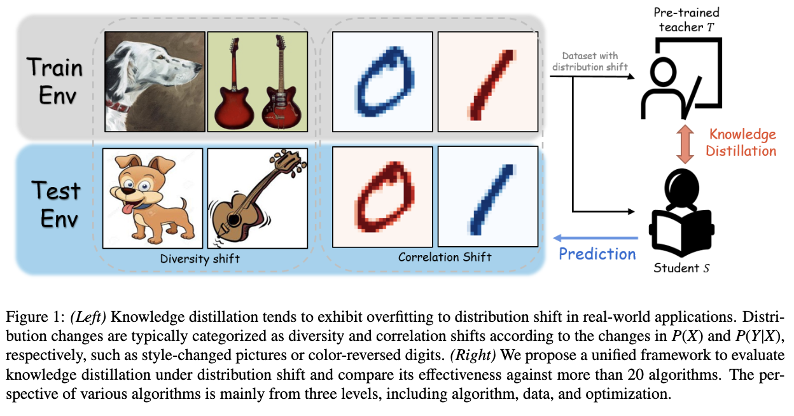

> **의견 : Framework 표현**
> 일단, Framework를 설명한다는 느낌은 크게 나지 않는 그림이다. Distribution Shift의 유형을 보여주는 것은 좋지만, Train과 Test의 구분 및 실제 KD 과정이 직관적으로 드러나지는 않는다.
>
> 이미지를 이해하기 쉽게 하려면 Student를 조금 줄이고, **Knowledge Distillation의 방향을 Teacher → Student로 단방향**으로 표현하는 것이 좋을 것 같다. 추가적으로 Test Environment를 Train Environment와 명확히 분리해야 할 것 같다. 현재 그림은 Test 데이터도 학습 과정에 함께 들어간다는 느낌이 든다.
>
> ```text
> [Training — Source Domains]
>
> Train Data ───┬──> Teacher T ── Knowledge ──┐
>               │                            ├──> Student S
>               └──> Ground-truth ───────────┘
>
> [Evaluation — Unseen Target Domain]
>
> Test Data ───> Trained Student S ───> Prediction / Evaluation
> ```
>
> → **Source Domain만 이용하여 Teacher와 Student를 학습하고, Unseen Target Domain은 학습에 사용하지 않고 최종 Evaluation에만 사용한다는 점**이 드러나면 좋을 것 같다.
{: .prompt-info }

### Table 5 & Figure 3

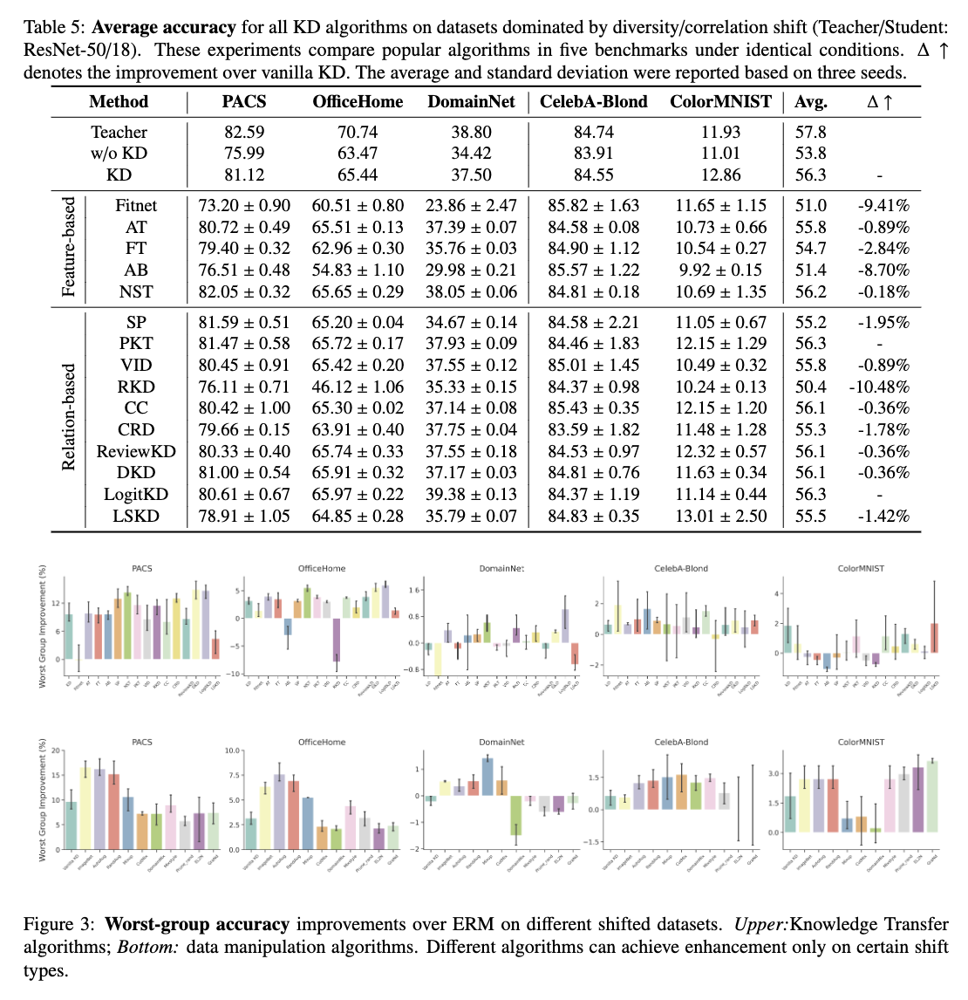

- **Average Accuracy :** 대부분의 복잡한 KD 방법들은 Vanilla KD보다 평균적인 성능이 떨어지거나 비슷한 수준을 기록한다.
- **Worst-group Accuracy :** 반면, Worst-group의 경우 ERM(w/o KD) 대비 성능 향상을 기록하는 KD 기법들이 상당수 존재한다. 
- **Data Manipulation :** 데이터 전략에서도 Worst-case 성능 향상을 가져올 수 있다. 단, 모든 방법에서 일관적으로 나타나는 것은 아니다.
- **Distribution Shift 유형에 따른 차이 :**
	- **Diversity Shift :** 상당수 KD 방법이 일반화 성능을 개선한다.
	- **Correlation Shift :** 성능 개선이 일관적이지 않으며, 오히려 악화되는 경우도 존재한다.
	- Data Augmentation과 Pruning 역시 Dataset 및 Shift 유형에 따라 효과가 달라진다.

→ **어떤 KD 알고리즘도 모든 Distribution Shift 조건에서 일관된 성능 개선을 보장하지 못한다.** 또한 복잡한 KD 방법이 반드시 Vanilla KD보다 좋은 일반화 성능을 보이는 것은 아니다.

> **의견 : "단순함"이 일반화에 유리한 관점일까?**
> 단순한 Vanilla KD가 복잡한 KD 방법들보다 좋은 성능을 보이는 경우가 많다. 그렇다면 **복잡한 Knowledge Transfer가 오히려 일반화를 방해하는 것은 아닐까?**
{: .prompt-info }
### Figure 8

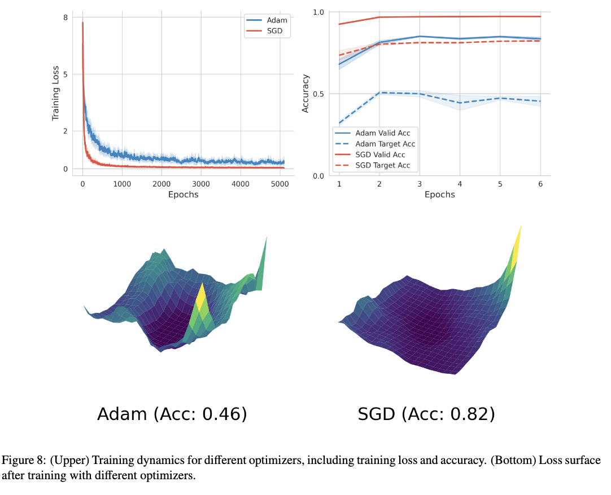

- **Adam이라고 항상 좋은 것은 아니다.**
- 논문의 PACS 실험에서는 SGD가 Adam보다 높은 일반화 성능을 기록한다.
	- SGD Baseline : 82%
	- Adam : 62%

> **의견 : Optimizer에 따른 일반화 성능**
> SGD도 다시 살펴볼 필요가 있을 것 같다. 특히 Adam이 항상 더 좋은 성능을 보이는 것은 아니며, Distribution Shift 환경에서는 Optimizer에 따른 차이가 크게 나타날 수 있다.
>
> 추가적으로 **AdamW, Adafactor, Lion, Muon 등 다른 Optimizer들도 비교**해 보면 좋을 것 같다.
{: .prompt-info }


# 6. Conclusion

Distribution Shift 문제는 KD의 성능 저하를 야기하기에, Student를 위한 KD 방법을 선택할 때 <strong>"No Free Lunch"</strong>가 존재한다. 즉, <strong>모든 Distribution Shift 상황에서 최적인 KD 방법은 없다.</strong>

- <strong>Knowledge distillation works</strong>(여전히 <strong>지식 증류는 효과적</strong>) : Distribution Shift 상황에서 Overfitting에 취약한 경량 모델(Student)에 KD를 적용하는 것을 권장한다. 이는 <strong>Teacher의 지식을 전달하는 것 자체가 새로운 환경에 대응하는 데 도움</strong>이 될 수 있기 때문이다.
- <strong>Exploring novel algorithms is required</strong>(<strong>새로운 알고리즘</strong>이 필요하다) : 기존의 복잡한 KD 방법들은 <strong>Vanilla KD에 비해 평균적으로 성능 개선이 제한적이며, WGA 상황에서도 일관된 성능 향상을 보장하지 않는다.</strong> 특히 <strong>Correlation Shift</strong> 측면에서는 더욱 요구된다.
- <strong>Augmentation cannot guarantee robust student</strong>(<strong>증강이 항상 좋은 것</strong>만은 아니다) : Data Augmentation은 일반화에 유용한 Feature를 추출하는 데 도움을 줄 수 있지만, 항상 효과적인 것은 아니다. 따라서 단순히 다양성을 증가시키기보다 <strong>Student의 Robustness를 개선할 수 있는 새로운 Data-level 접근</strong>이 필요하다.
- <strong>Do not forget pre-training and SGD</strong>(<strong>사전 학습과 SGD</strong>) : Distribution Shift 상황에 있어서 사전 학습과 Optimizer의 선택이 중요하다. 즉, Adam이라고 해서 항상 좋은 것만은 아니며, SGD가 더 효과적인 경우도 존재한다.

저자들은 Distribution Shift 환경에서 KD를 평가하기 위한 새로운 Paradigm인 <strong>ShiftKD</strong>를 제안한다. 이를 위해 KD의 학습 문제를 Multiple Domain으로 확장하고, <strong>Algorithm, Data Manipulation, Optimization</strong>의 세 관점에서 5개 Dataset과 30개 이상의 방법을 평가하는 Benchmark Framework를 구축하였다.

이를 통해 Distribution Shift 환경에서 KD를 적용할 때 고려해야 할 주요 요인과 실험적 결과를 제시한다.
## 4.4. More Discussion

- <strong>Diversity Shift</strong> : <strong>여러 KD 알고리즘이 Distillation 이전보다 성능을 개선된다.</strong> 그러나 Domain과 KD 알고리즘에 따라 결과는 달라진다.
- <strong>Correlation Shift</strong> : <strong>Teacher의 허위 상관관계(Spurious Correlation)가 Student에게 전달</strong>될 수 있기 때문에 <strong>취약</strong>하다. 특히 대부분의 KD 알고리즘은 Teacher와 Student 사이의 성능 격차를 충분히 줄이지 못한다.
- <strong>Vanilla KD</strong> : 평균적으로 Vanilla KD는 좋은 결과를 내지만, <strong>Teacher의 Bias를 전달받는 문제</strong>가 발생한다.
- <strong>Data Manipulation</strong> : 데이터를 조작(Augmentation, Pruning 등)하는 방식은 위의 Bias를 어느 정도 줄일 수 있지만, 이는 <strong>조작 결과가 Ground Truth와 얼마나 관련 있는지</strong>에 많이 의존한다.
- <strong>Do not trust prior</strong> : 이미 실험된 특정 KD 방식, 즉 사전 결과(Prior)가 좋더라도 이를 새로운 환경에서 그대로 신뢰할 수는 없다. 실제 환경에서는 Target Distribution이 알려져 있지 않으며, Unknown Environment의 데이터 수집에도 많은 비용이 필요하다.
	- 따라서 <strong>특정 KD 방법이 Vanilla KD보다 효과적이지 않다는 결론 역시 해당 실험 환경에 제한된 주장</strong>이다.
## 4.5. Connecting KD to Information Theory

##### Donsker-Varadhan Variational Representation (Polyanskiy and Wu, 2014)

$$
I(X;Y)=\sup_{c:\mathcal X\times\mathcal Y\to\mathbb R} I_c(X;Y)
$$

$$
I_c(X;Y)
=\mathbb E_{(x,y)\sim P_{XY}}[c(x,y)]
-\log\mathbb E_{(x,y)\sim P_X\times P_Y}[\exp(c(x,y))]
$$

- $I(X;Y)$ : <strong>X와 Y가 얼마나 서로 관련되어 있는지</strong>를 나타내는 상호 정보량(Mutual Information, MI)
- $c(x,y)$ : 두 입력이 얼마나 잘 어울리는지 점수를 주는 <strong>Critic Function</strong>

저자들은 KD의 KL Divergence 최소화를 Student와 Teacher 간의 MI를 증가시키는 <strong>정보 최대화 원칙의 관점과 연결</strong>한다. 그러나 <strong>Student–Teacher 간 MI를 최대화한다고 해서 Distribution Shift 상황에서도 좋은 성능이 보장되는 것은 아니다.</strong> 이를 설명하기 위해 MI 분해를 사용한다.

> **정보 최대화 원칙 (Tsai et al., 2020; Ahn et al., 2019)**
> <strong>서로에 대해 알아낼 수 있는 정보가 많아지도록 하는 원칙</strong>으로, 서로 잘 맞으면 한쪽의 출력만 보고 다른 쪽의 출력을 더 잘 짐작할 수 있다고 본다. 이때 둘 사이의 정보량이 크다고 할 수 있다.
>
> 쉽게 예제를 들어 설명하자면 <strong>X와 Y를 원래 짝인 카드와 무작위로 섞어 만든 카드로 나누고</strong>, Critic Function이 원래 짝에 더 높은 점수를 주게 하는 방법이다. 즉, 원래 짝과 무작위 짝의 점수 차이를 크게 만드는 방식으로 X와 Y 사이의 공유 정보를 학습할 수 있다.
>
> ※ 이는 Critic Function을 이용한 MI 추정 방식을 설명하기 위한 직관적인 예시이다.
{: .prompt-info }

##### Chain Rule of Mutual Information (Polyanskiy and Wu, 2014)

$$
\underbrace{I(S;Y)}_{\text{Supervised goal}}
=
\underbrace{I(S;T)}_{\text{KD goal}}
+
\underbrace{I(S;Y\mid T)}_{\text{Domain-invariant}}
-
\underbrace{I(S;T\mid Y)}_{\text{Domain-variant}}
$$

- $I(S;Y)$ : Student가 Label $Y$에 대해 가지는 정보량(Supervised Goal)
- $I(S;T)$ : Student와 Teacher가 공유하는 정보량으로, 저자들은 이를 <strong>지식 전달 효율성(KD 목표)</strong>과 연결한다.
- $I(S;Y\mid T)$ : Teacher의 정보 이외에 Student가 <strong>추가로 Label</strong> $Y$<strong>에 대해 학습</strong>한 정보. 이 값이 작다는 것은 Transfer Learning의 정보 이론적 분석에서 사용되는 표준적인 가정이다.
- $I(S;T\mid Y)$ : Label $Y$가 주어졌을 때 Student와 Teacher 사이에 <strong>공유하는 정보</strong>로, 저자들은 이를 Label과 무관한 Redundant Information과 연결한다.

그러나 Distribution Shift가 발생하면, Teacher와 Label 사이의 허위 상관관계나 Style 변화에 의해 통계적 의존성이 방해를 받아 Teacher를 통해 Label과 관련된 정보를 전달받는 데 어려움이 발생한다.

> **용어 정리**
> - <strong>Domain-invariant</strong> : Domain이 달라져도 변하지 않고, Target 예측에 유용한 정보
> - <strong>Domain-variant</strong> : Domain에 따라 달라지는 정보
>
> ※ 위 수식에서 각 MI 항을 Domain-invariant / Domain-variant로 연결하는 것은 저자들의 해석이며, Chain Rule 자체가 이러한 대응을 보장하는 것은 아니다.
{: .prompt-info }

$$
I(S;Y)\downarrow
=
\underbrace{I(S;T)}_{\text{Misleading}\uparrow}
+
\underbrace{I(S;Y\mid T)}_{\text{Compensation}\downarrow}
-
\underbrace{I(S;T\mid Y)}_{\text{Redundancy}\uparrow}
$$

※ 논문의 Equation (10)은 $I(S;Y)\uparrow$로 표기되어 있지만, 본문상 아래 화살표이다.

- $I(S;T)$ : Teacher가 Spurious Feature에 의존하면, Student가 Teacher를 잘 모방해도 유용한 Target 정보가 아니라 편향된 정보를 배울 수 있다. 즉, <strong>Misleading Knowledge를 전달받을 수 있다.</strong>
- $I(S;Y\mid T)$ : Teacher가 Label에 대한 유용한 정보를 제공하지 못하면, Student가 Teacher의 지식만으로 부족한 Label 정보를 충분히 보완하기 어렵다.
- $I(S;T\mid Y)$ : Label과 무관한 Style이나 Spurious Feature를 Teacher와 Student가 함께 학습해 <strong>Domain-variant한 정보가 증가</strong>할 수 있다.

즉, 저자들은 단순히 $I(S;T)$를 크게 만드는 것이 아니라, <strong>불필요한 Domain-variant Information을 줄이면서 Label과 관련 있는 정보를 보존</strong>해야 한다고 주장한다.

종합하자면 <strong>Teacher Model이 거의 효과가 없는 상황에서는 Student의 독립적인 학습보다 KD를 사용하는 경우 성능이 낮아질 수 있음</strong>을 시사한다. 위의 MI 분해를 사용하면 왜 각 모델들의 성능이 감소하였는지 결과를 해석할 수 있다.

| Method | 논문의 설명 |
| :--- | :--- |
| **FitNet** | Intermediate Feature를 직접 Matching하기 때문에 Teacher의 Spurious Feature까지 전달할 수 있음 |
| **NST** | Neuron Selectivity의 통계적 구조를 Matching하여 Domain-invariant한 구조를 포착하고, Domain-specific Information의 영향을 줄이는 데 도움이 될 수 있음 |
| **Logit-based KD** | Soft Label의 Semantic Information을 전달하지만 Teacher Logit에 포함된 Bias 역시 전달할 수 있음 |


# 1. Introduction

ML 시스템은 효과적이지만 주요한 한계가 존재한다.
1. <strong>Computational Cost</strong> : 높은 계산량으로 인해 자원이 제한된 환경, 특히 Mobile Device와 같은 경량 환경에서의 사용이 제한된다.
2. <strong>Distribution Shift</strong> : 추론 시의 데이터 분포가 학습 시의 데이터 분포와 다른 상황이며, 이는 <strong>모델이 새로운 분포에 잘 일반화되지 못하여 성능 저하가 발생할 수 있다.</strong>

이러한 두 문제를 동시에 해결하기 위해 저자들은 KD(1. Computational Cost : Large Model → Small Model로 Compression)를 Distribution Shift(2. Distribution Shift : 실제 환경에서 발생하는 분포 변화) 상황에서 다루려고 한다.

KD는 일반적으로 <strong>거대한 Teacher 모델의 행동과 지식을 가벼운 Student 모델이 잘 모방</strong>하도록 훈련하는 모델 압축 기법이다. 많은 연구들이 <strong>독립 동일 분포(i.i.d.)를 가정</strong>하여 지식 전이와 일반화를 분석한다.
그러나 Stanton et al.(2021)에서는 <strong>최적화 문제(최적화의 어려움)와 증류 대상인 데이터셋의 영향</strong>으로 Student가 Teacher의 Predictive Distribution을 완벽하게 모방하지 못할 수 있고(KL Divergence를 충분히 줄이지 못함), <strong>Teacher를 잘 모방하는 것이 항상 더 높은 일반화를 가져오는 것은 아니라고</strong> 주장한다.

> **독립 동일 분포(i.i.d.)**
> 데이터가 <strong>서로 독립적이고 같은 분포에서 나온다.</strong> 예를 들어 시험문제를 풀 때 <strong>연습문제와 비슷한 규칙과 비율로 시험문제가 나오고, 각 문제끼리 서로 독립적인 상황이다.(영향을 주지 않음)</strong>
{: .prompt-info }

<strong>실제 환경에서는 i.i.d. 가정이 성립하지 않을 수 있으며, 이는 증류 후에도 Student의 성능 저하</strong>로 이어질 수 있다. 또한 기존의 KD에 대한 설명만으로는 이러한 Distribution Shift 환경에서의 성능을 충분히 설명하기 어렵다.


위의 Fig 1.은 Distribution Shift와 그 종류에 대해 설명하고 있으며 자세한 설명은 [위의 설명](#link1)을 참고하길 바란다.
훈련 환경은 깨끗하고 잘 정렬되어 있을지 몰라도, 배포한 실제 환경에서는 Diversity Shift와 Correlation Shift가 일어날 수 있다. 즉, 모델의 크기(Model Capacity)와 일반화 성능 사이에서 Trade-off가 발생할 수 있다.

대부분의 KD 연구는 <strong>성능 향상에 집중</strong>하였으며, 이러한 <strong>Distribution Shift의 영향까지 탐구한 연구는 많지 않다.</strong> 아래는 Distribution Shift와 관련된 일부 KD 연구들이다.

- Fang et al. (2021): Out-of-domain Data를 활용하여 In-domain Distillation 성능 개선
- Zhou et al. (2022): Aggressive Data Augmentation을 통해 KD의 Out-of-domain Generalization 개선
- Do et al. (2022): Data-free Knowledge Distillation 접근

위의 연구들과 달리 ShiftKD는 새로운 KD 방법으로 성능을 개선하는 것이 아닌 <strong>기존 방법들이 Distribution Shift 환경에서 얼마나 효과적으로 대응하는지 평가</strong>하는 것에 초점을 맞춘 논문이다.
즉, 벤치마크 논문이다. 아래는 3가지의 주요 질문이다.

1. <strong>Q1. Do existing knowledge distillation methods remain effective under distribution shift?</strong> : <strong>기존 KD 알고리즘이 Distribution Shift 환경에서도 효과적인지</strong>, 특히 전달하는 Knowledge의 유형에 따라 Student가 Teacher와 얼마나 잘 Alignment되는지 확인한다.
2. <strong>Q2. Which data strategies, such as augmentation or pruning, are better for mitigating distribution shifts?</strong> : Data Augmentation이나 Data Pruning과 같은 <strong>Data Strategy 중 어떤 방법이 Distribution Shift를 완화하는 데 효과적인지</strong> 확인한다.
3. <strong>Q3. What are the most effective optimization techniques in this context?</strong> : <strong>Distribution Shift 환경에서 어떤 Optimization Technique가 효과적인지</strong> 확인한다.

이러한 질문들을 해결하기 위해 Distribution Shift 상황에서 KD를 평가할 수 있는 프레임워크인 ShiftKD를 제안하였고, 기존 i.i.d. 환경의 KD 설정을 Multiple Domain 환경으로 확장하여 평가한다.
해당 벤치마크는 5개의 Dataset을 2가지 Shift(Diversity, Correlation)에 따라 평가하며, Algorithm(KD 기법), Data Strategy, Optimization의 세 가지 관점에서 분석한다.

추가적으로 저자들은 30개 이상의 방법 및 설정을 포함하는 체계적인 평가 벤치마크를 구축하고, Average Accuracy뿐만 아니라 Worst-case 성능도 함께 분석한다. 이를 통해 실제 Distribution Shift 환경에서 기존 KD 방법들의 효과와 한계를 확인하고자 한다.

<strong>주요 Contribution</strong>
1. <strong>Distribution Shift 환경에서의 KD Framework 정의</strong> : 기존 i.i.d. 가정을 재검토하고, Multiple Domain을 고려하여 KD의 학습 및 평가 문제를 재정의한다.
2. <strong>Systematic Evaluation Benchmark 구축</strong> : 30개 이상의 KD 방법 및 설정을 포함하여 Distribution Shift 환경에서 기존 방법들의 성능을 체계적으로 비교한다.
3. <strong>Distribution Shift에서 KD의 효과와 한계 분석</strong> : Average 및 Worst-case 성능을 분석한 결과, 모든 Shift 환경에서 일관되게 효과적인 KD 방법은 드물며 Vanilla KD만으로도 충분한 경우가 존재한다. 또한 Distribution Shift에서는 Dark Knowledge와 Data Augmentation의 효과가 감소할 수 있으며, Data Pruning과 Pre-training은 Student의 Task에 따라 효과가 달라질 수 있음을 확인한다.


# 2. ShiftKD Framework

## 2.1. Preliminaries

### Knowledge Distillation (KD)

i.i.d. 환경에서의 기본 KD를 가정하자.
$$
\min_{\theta_s} \mathbb{E}[\alpha L_{KL}(S, T) + (1 - \alpha)L_{CE}(S, Y)]
$$
- $\theta_s$ : Student(S)의 parameter
- $L_{KL}$ : Student(S)가 Teacher(T)를 **모방하도록 구성한 KL Divergence** → **Teacher의 지식 전달**
- $L_{CE}$ : Student(S)의 **출력과 정답 레이블 간의 Cross Entropy** → **Ground-Truth를 이용한 지도학습**
- $\alpha \in [0, 1]$ : Distillation Loss의 가중치(Hyperparameter) → 실제 Label과 Teacher의 모방 정도를 얼마나 강조할지 조절

### KD under distribution shift (non-i.i.d. case)

$$
D_{train} = \{D_e = (X_e, Y_e)\}_{e=1}^{K}
$$
- $K$ : 유사하지만 서로 다른 Domain 수
- $D_e$ : e번째 도메인의 데이터
    - $X_e$ : e번째 도메인의 입력 데이터
    - $Y_e$ : e번째 도메인의 Label
- $P^e_{XY}$ : e번째 도메인의 Joint Distribution
    - $P^e_{XY} \neq P^{e^{\prime}}_{XY}, \ e \neq e^\prime$
    - $e, e^\prime \in \{1, 2, 3, ..., K\}$

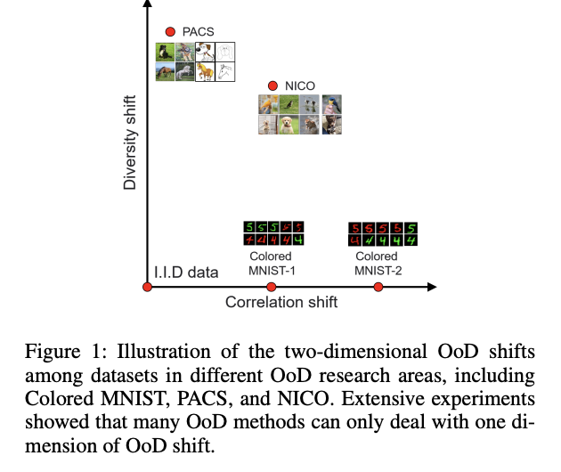
> Haoyue Bai et al. (AAAI, 2021)

보통의 연구에서 KD 최적화 함수는 i.i.d. 가정하에서 논의된다. 그러나 현실적으로 Train 데이터의 분포와 Test 데이터의 분포가 같지 않은 경우가 많다.
$$
P_{train} \neq P_{test}, \quad \phi \neq \psi
$$
- $\phi$ : Training Environment의 확률함수
- $\psi$ : Test Environment의 확률함수

이는 곧 Student Model의 일반화 성능 저하로 이어질 수 있다.

이 논문은 이러한 상황, 즉 **Distribution Shift에서의 KD**를 다루려고 한다. 이때의 목표는 **보지 못한 환경** $D_{test}$(**훈련 과정에서 접근 불가**)에서 잘 수행할 수 있는 학생 모델 $S(X;\theta_s)$을 만드는 것이다.
그러나 현실적으로 **제한된 Student Model Capacity와 기법들의 사용으로 인해 Trade-off**가 발생한다.
따라서 저자들은 기존 KD 방법들이 Distribution Shift에서도 유효한지 평가하고자 한다. 특히 **Teacher가 강건하지 않더라도 KD를 통해 강건한 Student를 얻는 것**을 목표로 한다.

## 2.2. Framework Setting

아래의 3가지 기준으로 Framework를 구성하였다.

- **알고리즘 수준(Algorithm-level)** : KD 알고리즘과 전달하는 Knowledge의 유형
- **데이터 수준(Data-level)** : 데이터 조작(Augmentation, Pruning)
- **최적화 수준(Optimization-level)** : Hyperparameter, Pre-training, Optimizer 등의 최적화 관련 부분

### Transferable Knowledge Algorithms
어떤 지식을 전달해야 할까?

기존의 KD 식을 아래와 같이 변형하였다.
$$
\min_{\theta_s} \mathbb{E} [\alpha L_{KL}(S, T) + (1 - \alpha)L_{CE}(S, Y) + \beta L_{reg}]
$$
- $L_{reg}$ : KD의 정규화 항으로, **다양한 지식 소스를 전달하기 위한 Loss** → 예를 들어 Feature-based KD에서는 Teacher와 Student의 Feature가 유사해지도록 하는 Loss가 해당
- $\beta$ : Trade-off Hyperparameter

> **참고 : 기본 KD 최적화 함수**
> $$
> \min_{\theta_s} \mathbb{E}[\alpha L_{KL}(S, T) + (1 - \alpha)L_{CE}(S, Y)]
> $$
{: .prompt-info }

1. **Logit-based** : 가장 일반적인 방식으로, **Teacher의 최종 Output을 직접 모방**한다. Teacher의 **Soft Label**로부터 Student가 학습하며, Softened Probability Distribution을 통해 Overfitting 완화에 도움을 줄 수 있다.
   e.g. KD (Hinton et al., 2015)
2. **Feature-based** : **Teacher의 중간 계층을 모방**한다. Attention Map과 같이 중간 계층에서 추출한 Feature를 전이하는 방식이다.
   e.g. AT (Zagoruyko and Komodakis, 2016) : Attention Map 모방
3. **Relation-based** : **Contrastive Learning이나 Similarity Matrix와 같이 모델 계층이나 샘플 간의 관련성을 정보**로 활용한다.
   e.g. SP (Tung and Mori, 2019) : Teacher의 상대적 유사도 정보를 전이
   e.g. CRD (Tian et al., 2019) : 판별 목적 함수를 사용하여 Instance-level Contrastive 정보를 전이

> **3가지 방법의 일반적인 수학적 표현**
> 아래 수식은 Knowledge 유형을 이해하기 위한 일반적인 예시이며, 원문 Section 2.2.1에 직접 제시된 수식은 아니다.
>
> - **Logit-based** : Teacher와 Student의 **최종 출력 확률분포**를 비교
> $$
> \mathcal L_{\mathrm{KD}} = D_{\mathrm{KL}}\left(p_T^\tau\Vert p_S^\tau\right)
> $$
>
> - **Feature-based** : Teacher와 Student의 **중간 Feature**를 비교. 필요한 경우 $g$를 사용하여 Feature 차원을 정렬하기 위한 변환 함수로 사용
> $$
> \mathcal L_{\mathrm{feature}} = \left\Vert f_T(X)-g(f_S(X))\right\Vert_2^2
> $$
>
> - **Relation-based** : Feature 간 Similarity 등 **관계를 표현하는 함수 $R$**을 이용해 구조를 비교
> $$
> \mathcal L_{\mathrm{relation}} = \left\Vert R(F_T)-R(F_S)\right\Vert^2
> $$
{: .prompt-info }

즉, 저자들은 **어떤 유형의 Knowledge가 Distribution Shift 환경에서 Student의 일반화에 효과적인지** 확인하려고 한다.

### Distillation Data Manipulation
어떤 데이터를 사용해 증류해야 할까?

Teacher가 불충분하거나 부적절한 데이터로 학습되면 완벽하지 않을 수 있으며, Student의 성능 역시 대규모 고품질 학습 데이터에 크게 의존한다. 특히 Distribution Shift 상황에서는 다양한 도메인을 충분히 대표하는 데이터를 확보하기가 더욱 어렵다.

따라서 데이터 수준의 전략을 사용하는 것은 자연스럽게 동반된다.
$$
\min_{\theta_s} \mathbb{E} [\alpha L_{KL}(S, T) + (1 - \alpha)L_{CE}(S^e, Y)], \quad (\hat{X}, Y) \in P_{tr}^{XY}
$$
- $\hat{X}$ : **조작 함수** $M(\cdot)$을 통해 입력 $X$를 조작한 데이터로, 이를 학습에 사용한다.

> **Equation의 표기**
> 원문에서는 $L_{CE}(S^e,Y)$로 표기하지만, $S^e$의 의미를 명확하게 정의하지 않았다.
> 또한 $(\hat X,Y)\in P_{tr}^{XY}$는 원문의 표기를 유지한 것으로, Augmentation을 통해 생성한 데이터가 항상 원래 Training Distribution을 따른다는 의미로 일반화해서는 안 된다.
{: .prompt-info }

1. **Data Augmentation** : **증류하려는 데이터가 학습 성능 저하의 원인**인 경우 데이터 분포의 Coverage와 도메인 간 강건성을 개선하는 데 유용할 수 있는 방법이다.$$
   M(X)= \hat{X}, \quad (\hat{X}, Y) \in P^{train}_{XY}
   $$

   저자들은 Randomization과 Generation에 초점을 두어 다양하고 복잡한 학습 환경을 생성하려고 한다.
   - **Randomization** : 무작위 변환을 통해 다양한 학습 환경을 생성
    e.g. AutoAugment, RandAugment
   - **Generation** : Sample이나 Feature를 조합하여 새로운 데이터를 생성
    e.g. Mixup (이미지와 Label의 Convex Combination)

   > **각 증강의 예시**
   > - **Randomization**
   >
   > 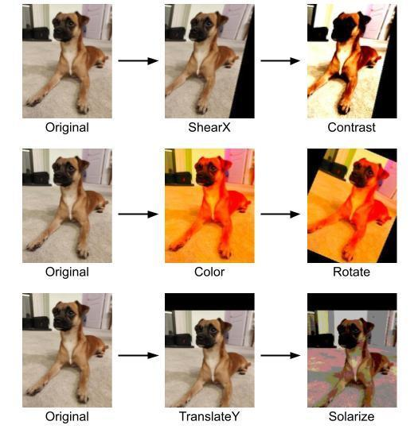
   > > https://docs.mosaicml.com/projects/composer/en/stable/method_cards/randaugment.html
   >
   > - **Generation**
   >
   > 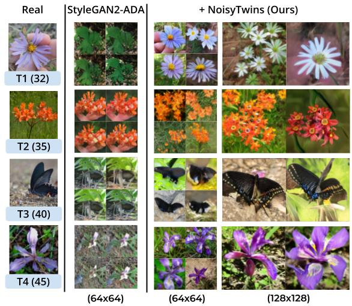
   > > https://rangwani-harsh.github.io/NoisyTwins
   {: .prompt-tip }

2. **Data Pruning** : 학생 모델이 중요하거나 대표적인 샘플로부터 증류되는 경우, **데이터셋에서 품질이 낮거나 중요하지 않은 샘플을 제거하여 데이터의 질을 높이는 방법**이다. 학습 효율성과 Distribution Shift에 대한 Robustness를 개선할 가능성이 있다.
   $$
   M(D_{train}) = \{\hat{D}_{train} = (\hat{X}, Y)\}
   $$
   $$
   (\hat{X}, Y) \in P^{train}_{XY}
   $$
	e.g. EL2N : 모델 예측과 Label의 차이를 기반으로 Sample의 중요도를 평가하고, 낮은 점수의 Sample을 제거

### Optimization Option
학생을 어떻게 학습시켜야 할까?

Stanton et al.(2021)은 KD에서 **서로 다른 Optimization Setting이 Student Model의 성능 차이를 유발할 수 있음**을 보였다. 특히 Distribution Shift 환경에서는 Unknown Test Environment에 접근할 수 없으므로, 저자들은 다른 변수들을 통제하면서 다음 요인들을 분석한다.

1. **Hyperparameter** : Distribution Shift가 존재하면 기존의 **i.i.d. 환경에서 효과적이었던 Hyperparameter가 새로운 환경에서도 적절하다고 보장할 수 없다**. 특히 Distillation Hyperparameter에 따른 지식 전달 효과를 분석한다.
2. **Pre-training** : **사전 학습을 통해 공통적인 Feature Representation을 학습**하도록 한다. 그러나 새로운 Distribution에서 필요한 Representation과 사전 학습된 Representation이 다르면 효과가 제한되거나 성능이 저하될 수 있다. 특히 Teacher Model에서도 이러한 문제가 발생할 수 있다.
3. **Optimizer** : **적절하지 않은 Optimizer 선택은 Student를 Local Optimum에 빠뜨릴 수 있다.** 따라서 Optimizer 선택에 따라 Distribution Shift에서의 일반화 성능이 달라질 수 있다.
4. **Evaluation Metric** : 서로 다른 평가 기준에서 Student의 신뢰성을 확인한다. 일반적인 Accuracy만으로는 강건성을 충분히 평가하기 어렵다.
   - Average Accuracy
   - Worst-Group Accuracy (WGA)
   - Expected Calibration Error (ECE)

   위 지표들의 구체적인 정의와 사용 방법은 Section 3.5에서 다룬다.

### Types of Distribution Shift

학습 데이터셋
$$
D_{train} = \{D_e = (X_e, Y_e)\}_{e=1}^{K}
$$
이 주어질 때, 각각은 결합분포 $P^e_{XY}$에서 샘플링된다고 하자.
인과 이론에 기반한 논문의 가정에 따르면 다음과 같다.
- $S^e$ : **Label을 결정하는 의미론적 요인(Semantic Factor)**
- $V$ : 입력의 Context나 Style 등 **도메인에 따라서 변화하는 요인(Variation Factor)**
- $X$ : 의미론적 요인 $S^e$와 변이 요인 $V$에 의해 결정
- $Y$ : Variation Factor $V$가 아닌 의미론적 요인 $S^e$에 의해 결정된다고 가정

Ye et al. (2022)는 Distribution Shift를 Diversity Shift(다양성 변화), Correlation Shift(상관관계 변화)로 구분한다. 두 환경의 확률함수를 각각 $\phi$와 $\psi$라고 하자.
- **Diversity Shift** : **환경에 따라 입력의 Style이나 Appearance 등 다양한 특성이 달라지는 상황**이다. 예를 들어 예술 회화 작품으로 학습하지만 만화로 Test하는 경우이다.$$
  F_{diversity}(\phi, \psi) = \frac{1}{2} \int_{V_1} |\phi(v) - \psi(v)| dv
  $$
  - $V_1 := \{v \mid \phi(v) \cdot \psi(v) = 0, v \in V\}$ : **두 분포의 Support가 겹치지 않는 영역**으로, 적어도 한쪽의 확률밀도가 0인 영역이다.
  - 즉, $F_{diversity}$는 두 환경의 Support가 겹치지 않는 영역에서 확률분포의 차이를 측정한다.

- **Correlation Shift** : **허위 상관관계(Spurious Correlation)의 변화로 인해 발생한다**. 예를 들어 빨간색 또는 녹색 숫자로 이루어진 데이터로 학습되었다면, Test에서는 색상과 Label 사이의 상관관계가 반전되는 상황이다(초록색 1 → 빨간색 1로 Test).  $$
  F_{correlation}(\phi, \psi) = \frac{1}{2} \int_{V_2} \sqrt{\phi(v) \cdot \psi(v)} \sum_{y \in Y} |\phi(y|v) - \psi(y|v)| dv
  $$
  - $y$는 이산적이다.
  - $V_2 := \{v \mid \phi(v) \cdot \psi(v) > 0, v \in V\}$
    - **두 환경이 공유하는 Variation Factor 영역** : $v \in V_2$ → 두 환경 모두에서 관찰되는 $v$에 대해 비교
    - **두 환경에서 해당 Variation Factor가 나타나는 정도** : $\sqrt{\phi(v)\psi(v)}$ → 두 환경에서의 확률밀도에 대한 기하평균 형태
    - **Variation Factor가 주어졌을 때 Label 분포의 차이** : $\sum_{y \in Y} | \phi(y \mid v) - \psi(y \mid v)|$ → 같은 Variation Factor가 관찰되었을 때, Label의 조건부 분포가 얼마나 달라졌는지

  즉, $F_{correlation}$은 **공유되는 Variation Factor에 대해 Label과의 통계적 관계가 얼마나 달라졌는지 정량화**하는 것이다.

> **허위 상관관계(Spurious Correlation)**
> 특정 환경에서는 두 변수 사이에 통계적인 연관성이 존재하여 예측에 유용해 보이지만, **환경이 달라지면 해당 관계가 유지되지 않아 일반화에 실패할 수 있는 불안정한 연관성**을 의미한다.
>
> 예를 들어 초록색 1과 빨간색 2를 주로 학습한 머신러닝 모델은 숫자의 형태가 아니라 색상을 가지고 Label을 예측할 수 있다. 이때 빨간색 1을 추론하도록 하면 모델의 성능이 급격하게 떨어질 수 있다.
>
> 즉, **Label 예측에 유용한 의미적 특징(Semantic Feature)이 아니라 환경에 의존하는 특징(Spurious Feature)에 의존하는 것**이 문제이다.
>
> 반드시 Pearson 상관계수가 높거나 두 변수 사이에 직접적인 인과관계가 없어야 한다는 의미는 아니다
{: .prompt-info }


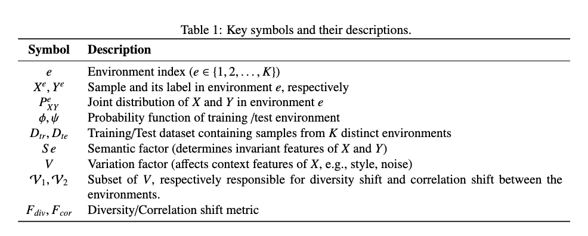


# 3. Benchmarking Details

30개 이상의 알고리즘을 평가하는 것을 포함, 고전적인 벤치마크 데이터셋 포함

## 3.1. Knowledge Transfer Algorithms

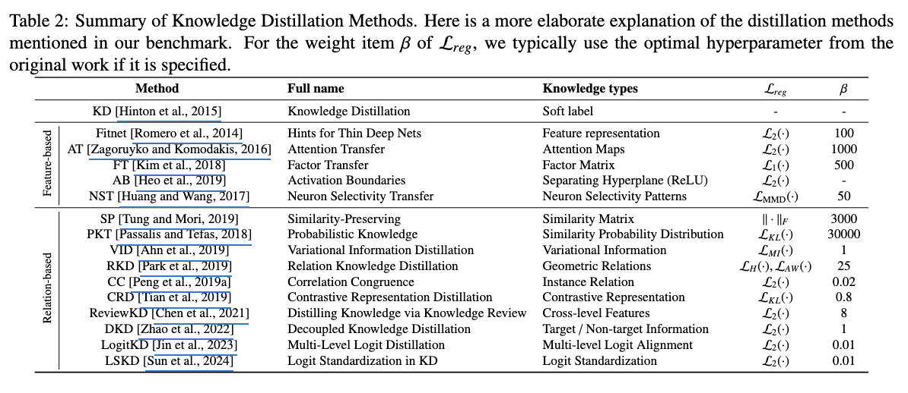

## 3.2. Data Manipulation Techniques.

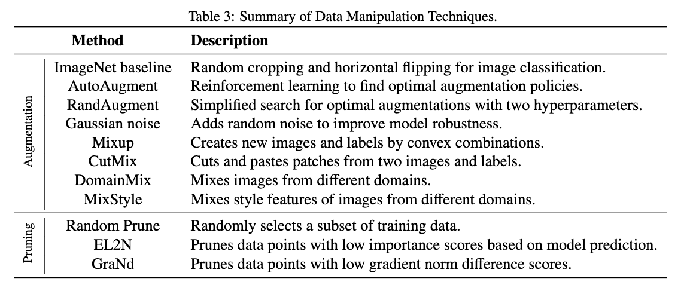

## 3.3. Optimization Options

1. Hyperparameter Sweep을 수행하고 비교 조건을 통제 → 서로 다른 환경에서 공정한 비교
2. Student 모델의 ImageNet 사전 학습 여부를 비교
3. Adam, SGD 비교
4. Student 모델 : ResNet, WRNet, MobileNet 등으로 교체

### 3.3.1. Shifted Datasets

- Diversity : PACS, OfficeHome, DomainNet
- Correlation : ColorMNIST, CelebA-Blond
	- ColorMNIST : 환경별 Flip Probability를 0.2, 0.1, 0.9로 설정하여 학습과 평가 환경에서 색상과 Label의 관계가 달라지도록 함
	- CelebA-Blond : CelebA에서 선택한 Subset의 Gender, Blond Hair Attribute 간 Joint Distribution 조절

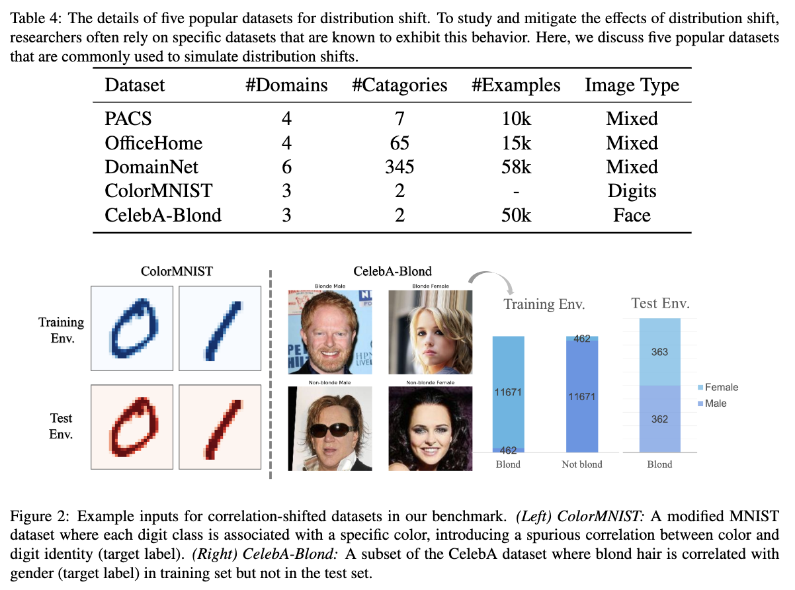

## 3.4. Evaluation Implementation

ResNet-50을 기본 Teacher로 사용하며, ImageNet에서 Pre-training 후 각 Dataset에 대한 KD에 사용한다.

Model Selection은 **Training-Domain Validation**을 기준으로 수행한다. 즉, Training Domain의 Validation 결과를 사용하며, Unseen Test Domain은 Model Selection에 사용하지 않는다.

## 3.5. Evaluation Metrics

- Average Accuracy : 모든 환경에 걸친 모델의 평균 정확도
- Worst-Group Accuracy (WGA) : 모델의 모든 환경 중 가장 낮은 정확도

추가적으로 Expected Calibration Error(ECE)를 보고한다.

> **Expected Calibration Error, ECE**
> 모델이 출력하는 신뢰도와 실제 정확도 사이의 차이를 수치화한 지표로, 0에 가까울수록 좋음
{: .prompt-info }


# 4. A Fine-grained Analysis
## 4.1. RQ1 : Performance Across Distillation Algorithms
기존 KD 알고리즘이 Distribution Shift 환경에서도 효과적인가? 특히 어떤 지식을 전달하는 것이 Student의 일반화에 도움이 되는가?

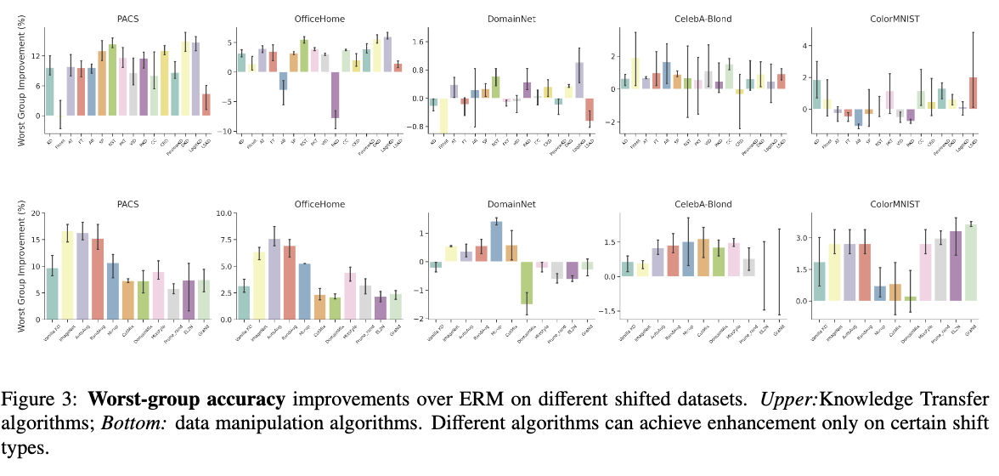

### KD can help lightweight models alleviate the shift effect, but not consistently.

<strong>KD는 경량 모델(Student)이 Distribution Shift의 영향을 완화하는 데 도움을 줄 수 있지만, 항상 일관적으로 효과적인 것은 아니다.</strong>

> **의견 : KD가 항상 효과적인가?**
> Fig.3을 보면 모든 KD 방법이 효과적인 것은 아닌 것 같다. 특히 DomainNet과 같이 일부 방법에서 WGA가 감소하는 경우도 존재한다.
>
> 즉, **KD가 Distribution Shift 환경에서 성능을 개선할 가능성은 있지만, 모든 Dataset과 알고리즘에서 효과를 보장하지는 않는다.**
{: .prompt-info }

저자들은 이러한 KD의 효과를 분석하기 위해 Grad-CAM을 수행하였다.

> **Grad-CAM(Gradient-weighted Class Activation Mapping, Selvaraju et al., 2017)**
> AI Model이 사진을 보고 특정 Class로 판단했을 때, **사진의 어느 부분이 해당 예측에 중요하게 작용했는지**를 시각적으로 보여주는 기술이다.
>
> 쉽게 말해, 개 사진을 보고 "개"라고 판단한 모델이 개의 얼굴을 중요하게 보았는지, 주변 배경을 중요하게 보았는지 확인할 수 있다.
>
> 단, Grad-CAM은 모델의 예측에 중요한 영역을 시각화하는 방법이지, 모델의 실제 판단 근거나 인과관계를 완벽하게 증명하는 것은 아니다.
{: .prompt-info }

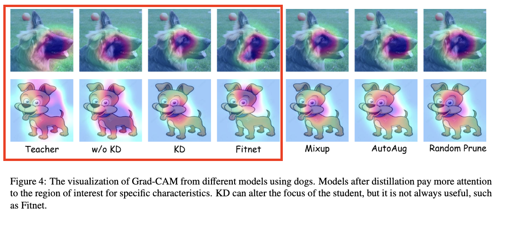
Fig. 4의 Grad-CAM을 통해 KD가 Student의 일반화 능력을 향상시킬 수 있다는 가능성을 보여준다. 일부 KD방법들은 Teacher나 w/o KD에 비해 <strong>분류에 중요한 영역에 더 집중</strong>하는 모습을 보여준다. 저자들은 이러한 현상이 <strong>Student가 Teacher보다 구조가 단순하므로 보다 일반적인 Feature를 학습</strong>하는 경향이 있어, Distribution Shift 상황에서 적응력을 높일 수 있다고 주장한다.
즉, **Student가 분류에 중요한 특징에 집중하도록 유도하면, 배경이나 스타일처럼 Domain에 따라 변하는 불필요한 정보의 영향을 줄이는 Noise Filtering 효과를 기대할 수 있다.** 다만 해당 결과의 Grad-CAM은 해석을 뒷받침하는 정성적 시각화이지, 이러한 해석을 인과적으로 입증하는 것은 아니다.

> **의견 : 작은 모델이 왜 더 일반적인 Feature를 학습할까?**
> 저자들은 Student가 Teacher보다 단순하기 때문에 더 일반적인 Feature를 학습하는 경향이 있다고 설명하지만, **모델이 작다는 사실만으로 일반화 성능이 뛰어나다고 단정할 수는 없다.**
>
> 작은 모델은 표현할 수 있는 정보가 제한적이므로 복잡한 특징보다 간단하고 반복적으로 유용한 특징을 학습할 가능성이 있다. 이러한 Capacity Constraint가 일종의 Regularization처럼 작동할 수 있다는 것이다.
>
> 그러나 반대 상황도 가능하다. 예를 들어 개의 형태를 이해하는 것보다 배경색만으로 분류하는 것이 더 간단할 수 있기 때문에, 작은 모델이 오히려 Spurious Feature에 더 의존할 가능성도 존재한다.
>
> 따라서 **작은 모델이 더 일반화에 유리하다는 것이 아니라, 제한된 Capacity 안에서 어떤 Feature를 선택하는지가 중요하다.**
>
> 또한 저자들은 Fig.4의 Grad-CAM을 근거로 이러한 경향을 설명하지만, **모델 크기 자체가 일반적인 Feature 학습을 유발한다는 인과관계까지 입증한 것은 아니다.**
{: .prompt-info }

그러나, <strong>어느 KD방법도 WGA, Average Accuracy에서 모든 Distribution Shift 환경에서 일관된 성능 개선을 보장하지는 못한다.</strong>

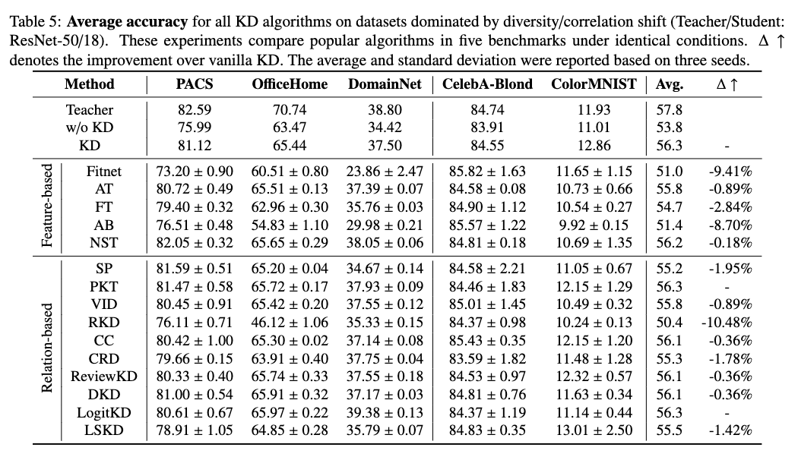

특히 Correlation Shift를 검증하기 위한 ColorMNIST에서는 어떠한 방법도 문제를 해결하지 못하였다.
- Diversity Shift : KD가 일반화 성능을 개선하는 경우가 많음
- <strong>강한 Correlation Shift</strong> : <strong>ColorMNIST와 같이 강한 Correlation Shift가 발생한 경우 KD의 효과가 제한적이다</strong> → Vanilla KD의 ACC.가 12.86%이고, LSKD가 13.01%로 w/o KD의 11.01%보다 성능이 높긴하지만, 해결했다고 보긴 어렵다.

즉, 저자들은 증류를 통해 Student의 일반화 오차를 개선할 수 있지만, <strong>Distribution Shift의 정도와 Teacher의 Prediction Error에 의해 제한될 수 있다</strong>는 가설을 제시한다.

### More complex algorithms offer limited improvement.


Fig.3에서와 같이 <strong>복잡한 알고리즘(Vanilla KD와 비교하여)는 일부 WGA에서 강력한 성능</strong>ㅇ,ㄹ 보이나, 모든 조건에서 개선되는것은 아니다.

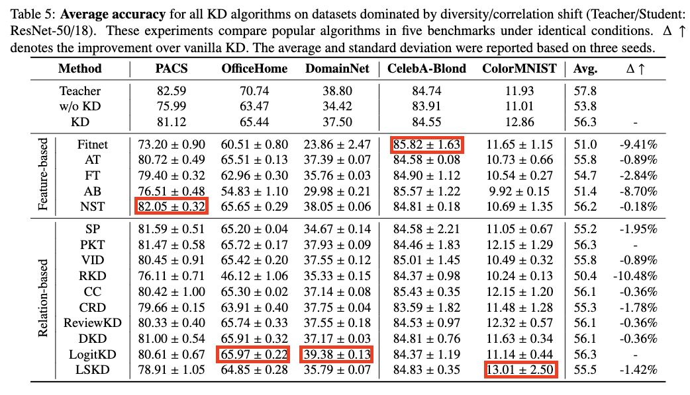

<strong>Tab.5를 보면 평균 정확도 측면에서는 복잡한 KD방법들이 VanillaKD를 일관되게 능가하지 못한다는것을 알 수 있다.</strong>

- PKT, DKD는 Dataset에 따라 Vanilla KD와 비슷하거나 더 나은 성능을 보임
- FitNet은 상대적으로 저조함
- PACS에서는 해당 실험 조건에서 NST가 좋은 성능을 보인다. 이는 Student로 하여금 Teacher의 Neuron Selectivity Pattern Distribution을 일치시키도록 하기 때문이며, 저자들은 이러한 방법이 PACS Dataset의 다양성을 포착하는 데 이점을 제공했을 가능성이 있다고 설명한다.

**전달하는 Knowledge의 유형에 따라 Dataset별 효과가 달라지며, 복잡한 Knowledge Transfer가 일관된 성능 향상을 보장하지는 않는다.**

### Larger teacher also offers limited improvement.

또한 **Teacher Model의 크기나 성능을 높이는 것 역시 항상 Student의 일반화 성능 향상을 가져오는 것은 아니다.**

저자들은 ResNeXt-50×4나 Transformer 기반 모델을 Teacher로 사용하여 이러한 현상을 분석한다.

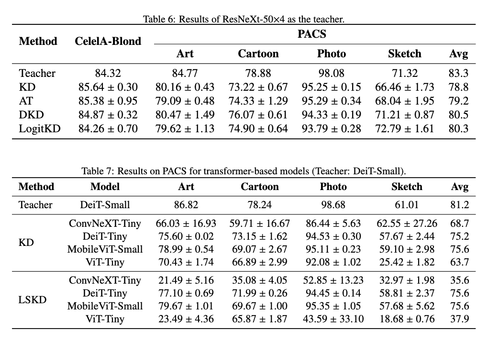

Tab.6에서는 ResNeXt-50×4를 Teacher로 사용했을 때, CelebA-Blond와 같은 Correlation Shift 환경에서 일부 KD 방법이 Teacher보다 높은 정확도를 기록한다.
이는 **증류 과정에서 Teacher가 학습한 허위 상관관계(Spurious Correlation)에 대한 의존성을 일부 억제할 수 있음**을 시사한다.
그러나 Diversity Shift인 PACS에서는 Teacher의 평균 정확도가 83.3%인 반면, KD를 적용한 Student들은 모두 이보다 낮은 평균 정확도를 기록한다.
즉, **더 크고 강력한 Teacher를 사용하더라도 Student가 동일한 일반화 성능을 얻는 것은 아니다.**

Tab.7에서는 Transformer 기반 Student 모델의 경우 대부분의 복잡한 알고리즘들이 Vanilla KD를 능가하지 못한다.

- DeiT-Tiny : Vanilla KD 75.2% → LSKD 75.6%
- ViT-Tiny : Vanilla KD 63.7% → LSKD 37.9%
- ConvNeXt-Tiny : Vanilla KD 68.7% → LSKD 35.6%
- MobileViT-Small : Vanilla KD 75.6% → LSKD 75.6%

즉, **KD의 효과는 Teacher–Student의 Architecture Compatibility에도 크게 영향을 받을 수 있다.**
특히 MobileViT-Small은 LSKD를 적용하더라도 전체 평균 성능을 유지하며, Art Domain에서는 78.99%에서 79.67%로 소폭 향상된다. 반면 ConvNeXt-Tiny나 ViT-Tiny에서는 치명적인 성능 하락이 나타난다. MobileViT-Small은 CNN과 Transformer를 결합한 Hybrid Architecture이므로, **Architecture의 차이가 Knowledge Transfer의 효율성과 안정성에 영향을 미칠 가능성**을 보여준다. 그러나 이것은 저자들이 해석한것 뿐이다.

> **의견 : Architecture Compatibility**
> 동일한 Architecture 계열에서 Knowledge Distillation을 수행하면 성능이 더 좋아질까?
>
> 예를 들어 Transformer Teacher → Transformer Student, Mamba Teacher → Mamba Student와 같이 동일 계열에서 증류하는 경우와, 서로 다른 Architecture 사이에서 증류하는 경우를 비교하면 흥미로울 것 같다.
>
> 추가적으로 Mamba 계열 모델에서도 Distribution Shift에 따른 KD 효과를 확인해 볼 수 있을 것 같다.
>
> 또한 Tiny나 Small 모델만 사용하는 것이 아니라, Student의 Capacity를 점차 증가시키면서 KD 효과와 OOD Generalization 사이의 관계를 분석해 보는 것도 좋을 것 같다.
>
> 다만 이러한 실험에서는 Parameter 수, Pre-training 여부, 학습 조건 등을 최대한 통제해야 Architecture 차이와 Model Capacity 차이를 구분할 수 있다.
>
> 특히 검증하고 싶은 것은 **Architecture Compatibility가 높을수록 Knowledge Transfer가 효과적인지, 그리고 이러한 효과가 Distribution Shift 상황에서도 유지되는지**이다.
{: .prompt-info }

### Low-level knowledge misleads the student while distribution shifts.

**Low-level Knowledge는 Distribution Shift 상황에서 Student 모델을 올바르지 못한 방향으로 이끌 수 있다.**

저자들은 CKA(Centered Kernel Alignment)를 통해 Teacher와 Student의 Layer별 Representation Similarity를 분석한다.

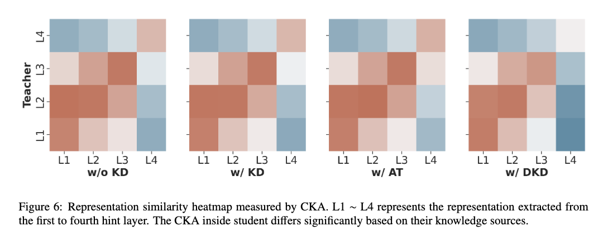

FitNet의 CKA에서는 Teacher와 Student 사이의 Representation이 상당히 다르게 나타나며, Grad-CAM에서도 유사한 문제가 관찰된다. 이를 더 자세히 분석하기 위해 저자들은 Ablation Study를 진행하였다. Teacher의 중간 계층을 Hint Layer로 사용하는 것보다 **Table 8의 결과와 같이 마지막 계층(L4)의 Knowledge를 전달하는 것이 가장 우수한 성능**을 보인다.

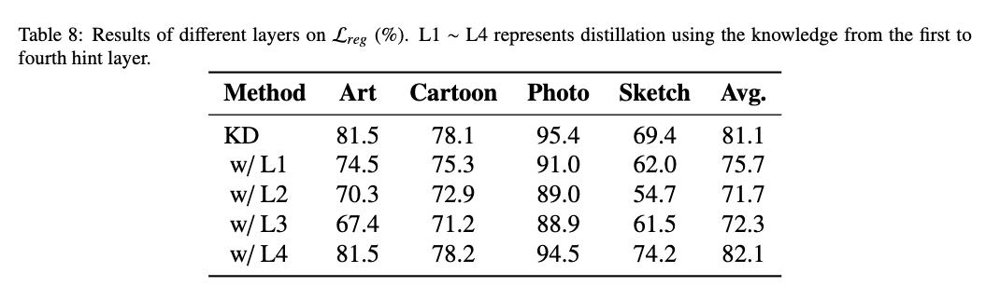

Hint Layer를 L1부터 L4까지 변경하여 비교하였다.

> **CKA(Centered Kernel Alignment, Kornblith et al., 2019)**
> 두 모델의 **Feature Representation이 얼마나 비슷한지 측정**하는 방법이다.
>
> 쉽게 말해, 동일한 입력 데이터를 두 모델에 넣었을 때, **각 모델의 Layer가 데이터를 얼마나 비슷한 방식으로 표현하는지**를 비교하는 것이다.
>
> 일반적으로 CKA Similarity는 0~1 사이의 값으로 표현하며, 1에 가까울수록 Representation이 유사하다고 해석한다.
>
> 이 논문의 Heatmap에서는 **붉은색일수록 높은 유사도**, 푸른색일수록 낮은 유사도를 나타낸다.
>
> 단, CKA가 낮다고 해서 반드시 이미지의 서로 다른 위치에 집중한다는 뜻은 아니다. CKA는 Representation의 유사성을 측정하며, 특정 이미지 영역에 대한 집중은 Grad-CAM과 같은 방법으로 분석한다.
{: .prompt-info }

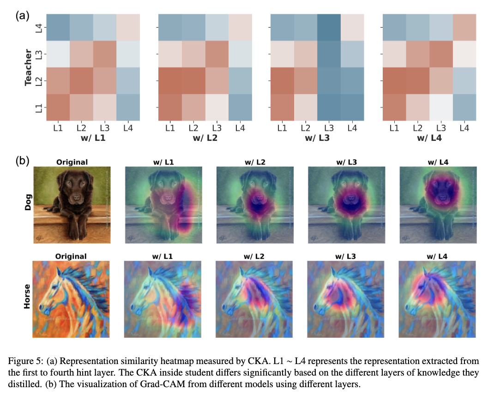


Fig.5의 (a)와 Tab.8의 결과를 비교하자면, 복잡한 KD 방법들의 성능 저하 원인은 **전달된 Feature와 실제 Task에 필요한 Representation 사이의 불일치**로 설명할 수 있다. 특히 L3에서는 CKA Similarity가 크게 감소하며, 이는 Teacher와 Student의 Feature Alignment가 잘 이루어지지 않았음을 시사한다. Tab.8을 보면 L1~L3의 Knowledge를 전달한 경우 Vanilla KD보다 평균 정확도가 낮아진다. 반면 L4의 Knowledge를 전달한 경우 가장 높은 정확도를 기록한다.
즉, **Low-level Feature에 과도하게 의존하는 것은 Distribution Shift 상황에서 성능 저하로 이어질 수 있으며, High-level Semantic Knowledge를 전달하는 것이 더 효과적일 수 있다.**

> **의견 : Low-level Feature와 High-level Feature**
> 일반적으로 초반 Layer에서는 Edge, Texture, Color 등 비교적 범용적인 특징을 학습하기 때문에 Transfer Learning에 유리할 수 있다.
>
> 그러나 Distribution Shift 상황에서는 Teacher가 가지고 있는 **Style이나 Spurious Correlation에 대한 편향까지 Low-level Representation에 인코딩되어 있을 가능성**이 있다.
>
> 따라서 이러한 Feature를 Student가 그대로 모방하면, Teacher의 허위 상관관계에 대한 의존성까지 전달될 수 있다고 생각한다.
>
> 즉, Teacher의 모든 Feature를 전달하는 것보다 **Domain에 독립적이고 의미론적으로 중요한 High-level Feature를 선택적으로 전달하는 것이 일반화에 더 효과적일 수 있다.**
>
> 특히 흥미로운 점은 Vanilla KD를 사용하거나 High-level Knowledge를 전달했을 때, Low-level Feature를 강제로 Matching하는 방법보다 좋은 성능을 보인다는 것이다.
>
> 다만 Vanilla KD 역시 증류 방법이므로, 이를 증류하지 않은 모델과 혼동해서는 안 된다. 또한 이 결과가 모든 Dataset에서 High-level Distillation이 우수하다는 것을 의미하지는 않는다.
{: .prompt-info }

즉, 상위 Layer의 정보를 증류함으로써 Student가 개의 얼굴과 같이 **분류에 중요한 영역에 집중하도록 유도할 수 있다.** 이는 Fig.5(b)의 Grad-CAM에서도 관찰된다. 따라서 **중요하지 않은 Layer에서 Teacher를 무분별하게 따르기보다, Domain의 변화에도 일반화될 수 있도록 Domain-independent하고 Semantically Meaningful한 Representation을 선택적으로 정렬해야 한다.**

> **의견 : Adaptive Distillation의 필요성**
> 이러한 결과를 보면 모든 Layer의 Knowledge를 동일하게 전달하기보다는, **Distribution Shift 유형이나 Layer별 Knowledge의 유용성에 따라 선택적으로 증류하는 Adaptive Distillation**이 필요하다고 생각한다.
>
> 특히 어떤 Knowledge가 새로운 Domain에서도 유효한지 판단할 수 있다면, Teacher의 Bias 전달을 줄이는 데 도움이 될 수 있을 것 같다.
{: .prompt-info }

### Student robustness is fundamentally constrained by both teacher robustness and data biases.

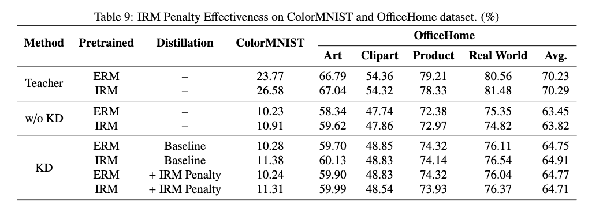

**Student의 Robustness는 근본적으로 Teacher Model의 강건성과 Training Data의 Bias에 의해 제약될 수 있다.** Tab.9를 보면 OOD 상황에서 Student의 강건성 향상이 Teacher의 강건성에 크게 좌우되는 것을 확인할 수 있다. ERM으로 학습한 Teacher에 비해 IRM으로 학습한 Teacher를 사용한 경우 Student의 성능이 소폭 향상된다. 또한 증류 과정에 IRM Penalty를 포함하더라도 ERM Teacher와 IRM Teacher 사이의 성능 차이는 미미하며, 추가적인 성능 개선도 나타나지 않는다.
즉, **Student는 Teacher가 가진 Bias의 영향을 벗어나기 어려우며, Student의 강건성은 Teacher의 Representation과 Training Data의 편향에 의해 제약될 수 있다.**
따라서 중요한 것은 단순히 Teacher의 성능이나 크기를 높이는 것이 아니라, **Teacher가 새로운 환경에서도 유효한 Knowledge를 학습하고 있는지**이다.
저자들은 이를 근거로 **Teacher가 가진 Systematic Bias가 KD를 통해 Student에게 전달될 수 있으며, Student가 Teacher의 Bias를 극복하는 데 한계가 있다**고 설명한다.
즉, **Teacher로부터 많은 Knowledge를 전달받는 것 자체보다 전달받는 Knowledge가 실제 Target과 관련 있는지가 중요**하다는 것이다.

다만 Table 9는 Teacher의 Robustness가 Student의 성능에 영향을 미친다는 점을 뒷받침하지만, Student의 성능이 Teacher의 성능을 절대 넘어설 수 없다는 수학적 상한을 입증한 것은 아니다.

> **용어 정리**
> - **ERM(Empirical Risk Minimization, 경험적 위험 최소화)** : 주어진 Training Data에서 평균 Loss를 최소화하는 일반적인 학습 방식이다. 문제 해결에 필요한 특징뿐 아니라 학습 환경에서 우연히 Label과 연관된 Spurious Feature도 활용할 수 있으므로, 허위 상관관계를 학습할 위험이 있다.
> - **IRM(Invariant Risk Minimization, 불변 위험 최소화)** : 여러 환경에서 **공통적으로 유효한 예측 규칙**을 학습하도록 유도하는 방법이다. 환경에 따라 달라지는 Spurious Correlation보다는 환경이 바뀌어도 유효한 특징을 학습하는 것을 목표로 한다. 다만 항상 이러한 특징을 학습하거나 OOD 성능을 개선한다고 보장할 수는 없다.
> - **IRM Penalty** : 여러 Training Environment에서 동일한 Classifier가 최적에 가깝도록 제약하는 Regularization Term이다. 이를 통해 특정 환경에만 유효한 특징에 과도하게 의존하는 것을 줄이려 한다.
{: .prompt-info }

> **IRM Penalty의 직관적인 이해**
> 예를 들어 ColorMNIST에서 숫자의 색상이 환경마다 Label과 서로 다른 상관관계를 가진다고 가정하자.
>
> ERM은 Training Data에서 정답을 잘 맞히는 것을 목표로 하기 때문에 색상에 의존할 수 있다.
>
> 반면 IRM은 여러 환경에서 공통적으로 유효한 예측 규칙을 찾도록 유도한다. 따라서 이상적으로는 환경에 따라 달라지는 색상보다 숫자의 형태와 같이 안정적인 특징을 활용하도록 학습하는 것이 목표이다.
>
> IRM Penalty는 이러한 목적을 학습 Loss에 반영하기 위한 제약 항이다.
>
> 그러나 Table 9를 보면 **IRM Penalty를 추가하는 것만으로는 Teacher 및 Training Data의 Bias를 충분히 해결하지 못한다.**
{: .prompt-info }

**Fig. 7 — Logit distribution of different methods on test set of ColorMNIST.**

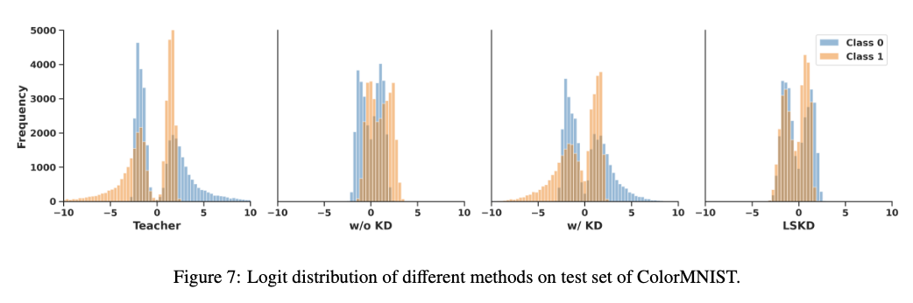

저자들은 ColorMNIST의 Correlation Shift를 분석하기 위해 다양한 KD 방법의 Logit Distribution을 비교한다.
- **Teacher** : 두 Class의 Logit이 뚜렷한 Bimodal Distribution을 형성한다.
- **w/o KD** : Logit이 0 근처에 집중되어 Prediction Uncertainty가 높다.
- **Vanilla KD** : Teacher의 Bimodal Structure를 일부 회복하지만 Class 사이의 구분은 여전히 제한적이다.
- **LSKD** : Vanilla KD와 마찬가지로 Class Separation에 한계가 존재한다.

Fig.7을 보면 Teacher Model의 출력은 뚜렷한 Bimodal Distribution을 보이며, 저자들은 이를 두 Class에 대해 높은 예측 확신도를 가진 것으로 해석한다. KD를 적용하지 않은 경우 Logit Distribution은 0 근처에 밀집되어 높은 Prediction Uncertainty를 보인다.
그러나 Vanilla KD를 적용한 경우 Teacher의 Bimodal Distribution을 부분적으로 회복하지만, 여전히 Class Separation은 제한적이다. LSKD에서도 동일한 한계가 나타난다. Tab.9에서도 다양한 IRM 제약을 적용하더라도 KD의 성능이 실질적으로 개선되지 않음을 보여준다.
즉, **증류는 Logit 수준에서 Teacher의 예측 확신도와 Class Separation을 일부 전달하는 데 도움을 줄 수 있지만, 그 효과는 여전히 제한적이다.**
이는 **Training Data에 존재하는 Bias와 이를 학습한 Teacher의 Bias가 KD를 통해 Student에게 함께 영향을 미칠 수 있기 때문**이라는 저자들의 설명을 뒷받침한다.

> **Dual Biases : Teacher Bias와 Training Data Bias**
> 저자들이 설명하는 Dual Biases는 Teacher와 Student 각각의 편향이 아니라, **Teacher Bias와 Training Data Bias**를 의미한다.
>
> 예를 들어 ColorMNIST에서는 다음과 같은 문제가 발생할 수 있다.
>
> 1. **Training Data Bias** : 학습 데이터에서 특정 색상과 Label이 강하게 연결되어 있다.
> 2. **Teacher Bias** : Teacher가 이러한 데이터를 학습하면서 숫자의 형태보다 색상에 의존하는 잘못된 예측 규칙을 학습할 수 있다.
> 3. **Knowledge Distillation** : Student가 Teacher의 예측을 모방하면서 올바른 Knowledge뿐 아니라 이러한 편향까지 전달받을 수 있다.
> 4. **Distribution Shift** : Test에서 색상과 Label의 상관관계가 반전되면 Student도 성능 저하를 겪을 수 있다.
>
> 즉, **Teacher를 잘 모방한다는 것과 새로운 환경에서 정답을 잘 맞힌다는 것은 서로 다른 문제**이다.
>
> Teacher가 잘못된 특징에 의존하면서 높은 Confidence로 예측한다면, Student가 그 예측을 잘 모방하더라도 OOD Generalization은 개선되지 않을 수 있다.
>
> 다만 Fig.7과 Tab.9만으로 두 Bias가 각각 성능 저하에 얼마나 기여했는지까지 분리해서 입증한 것은 아니다.
{: .prompt-info }

따라서 **KD가 Logit 수준에서 예측 Confidence와 Class Separation을 일부 개선할 수 있지만, Teacher 및 Training Data에 포함된 Bias까지 해결하기는 어렵다**고 설명한다.

### Extra information is required.

저자들은 Distribution Shift에 의해 발생하는 Data Heterogeneity가 기존 KD 과정에서 충분히 활용되지 않는다고 설명한다. 이를 해결하기 위해 Domain Index와 같은 추가적인 Context Information을 활용하거나, 데이터를 Context별로 명시적으로 Grouping하여 Student Model의 학습을 도울 수 있다고 제안한다. 이러한 추가 정보를 통해 Student가 **Teacher가 강건하지 않더라도 Spurious Correlation을 더 잘 인식하고 Domain-invariant Feature를 학습하도록 유도할 수 있다**고 설명한다. 다만 저자들은 이러한 방법을 향후 활용 가능한 방향으로 언급하며, Section 4.1에서 새로운 방법을 제안하거나 직접 실험으로 입증한 것은 아니다.

**i.i.d. 상황에서 유용한 Dark Knowledge는 Distribution Shift 상황에서 오히려 반대의 효과를 낼 수 있으며, 이는 Teacher가 학습한 Representation에 Context나 Style Information이 포함되어 있어 Student의 Overfitting을 유발할 수 있기 때문이다.**
따라서 **Teacher의 Knowledge를 얼마나 많이 전달하는가보다, 어떤 Knowledge를 선택적으로 전달해야 새로운 Domain에서도 유효한지가 중요하다.**

## 4.2. RQ2: The Role of Distillation Data

### Data augmentation helps marginally.

Data Augmentation은 Distribution Shift와 KD에 각각 효과적인 방법이지만, 두 상황이 결합되면 효과가 제한적이거나 Dataset에 따라 달라질 수 있다.


Fig. 3의 하단 그래프는 Data Manipulation 방법의 WGA 개선을 보여주며, Dataset과 Shift 유형에 따라 결과가 달라진다.

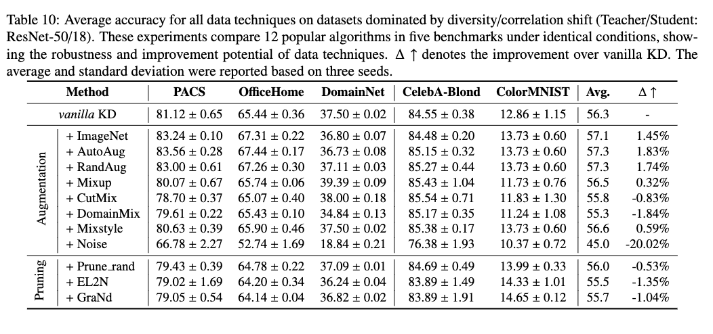
Table 10을 보면 Vanilla KD의 전체 평균 정확도는 56.3%이며, AutoAugment와 RandAugment는 각각 57.3%로 소폭 개선되지만 Gaussian Noise는 45.0%로 크게 감소한다.

- <strong>랜덤 기반 증강</strong>은 일부 Dataset에서 KD의 성능을 향상시킨다. 그러나 Gaussian Noise는 실제 데이터 분포나 Teacher가 학습한 지식의 특성에 적절히 부합하지 못해 성능이 크게 감소한다고 저자들은 설명한다.
- <strong>생성 기반 증강</strong>은 일부 Correlation Shift Dataset에서 효과적일 수 있으나 일관적이지 않다. CelebA-Blond에서는 CutMix(85.54%)가 AutoAugment(85.15%)보다 높지만, ColorMNIST에서는 AutoAugment(13.73%)가 CutMix(11.83%)보다 높다.

랜덤 기반 증강은 전체 평균에서 소폭 개선을 보였지만 항상 성능을 향상시키지는 않는다.
Mixup과 CutMix 같은 생성 기반 증강은 5개 Dataset의 전체 평균에서 RandAugment, AutoAugment보다 낮은 성능을 보였다. 저자들은 이러한 결과가 Distribution Shift 상황에서 KD에 영향을 주는 여러 요인 때문일 수 있다고 설명한다. 다만 Dataset에 따라 생성 기반 증강이 더 높은 성능을 기록하는 경우도 있다.
1. 생성 기반 증강은 <strong>원래 데이터 분포를 변경</strong>하여 Student의 일반화 능력을 저해하는 <strong>편향을 주입</strong>할 수 있다.
2. KD의 효과적인 방식은 <strong>Teacher와 Student의 학습 데이터를 정렬 하는데 달려 있다.</strong> 랜덤 증강은 관련 없는 특징을 도입하지 않고 다양성만 증가시킬 수 있다.
3. <strong>하이퍼 파라미터의 민감성을 제어하기 쉬워</strong> 더 큰 안정성과 적응성을 제공할 수 있다.
이는 저자들이 성능 차이를 설명하기 위해 제시하는 원인이고, 항상 효과적인것만은 아니라고 한다.

결과적으로 랜덤 기반 증강이 본질적으로 효과적이라는 가정은 자명해 보일 수 있다. 그러나 저자들은 그 성공 여부는 <strong>데이터의 특성과 Distribution Shift의 정도에 크게 의존한다</strong>고 설명한다. 이러한 변환의 효과는 <strong>Domain간 공통적으로 유지되는 invariant feature와 정렬 여부</strong>에 달려있으며, 실질적인 검증이 필요하다고 주장한다.

### Data pruning makes sense for students under distribution shift.

저자들은 전체 Training Sample의 75%만 선택해 Distillation을 수행해도 <strong>Pruning 이전 성능의 95% 이상을 유지</strong>할 수 있었다고 보고한다. 또한 Table 10의 5개 Dataset 평균에서는 Random Prune(56.0%)이 EL2N(55.5%), GraNd(55.7%)보다 높았으나, 모두 Vanilla KD(56.3%)보다는 낮았다.

<strong>Data Pruning 전략은 일부 Correlation Shift 상황에서 효과적일 수 있다.</strong> 특히 ColorMNIST에서는 GraNd(14.65%)와 Random Prune(13.99%)이 Vanilla KD(12.86%)보다 높다. 하지만 CelebA-Blond에서는 EL2N과 GraNd가 Vanilla KD보다 낮기 때문에 모든 Correlation Shift에 효과적이라고 볼 수는 없다. 저자들은 Pruning이 학습 데이터 품질을 개선하고 Overfitting을 줄일 수 있으며, Random Pruning은 <strong>인위적으로 설계된 중요도 지표에 포함된 Bias를 피하면서 데이터의 Noise와 중복성을 줄일 가능성</strong>이 있다고 해석한다. 이는 저자들의 원인 설명이며, Random Pruning이 모든 Dataset에서 가장 좋았다는 의미는 아니다.

### High-quality KD data is needed.

이 결과를 보면 KD는 고품질의 데이터가 필요하다. KD의 목적에 따라 증강 혹은 Pruning을 할 수 있다.<strong>증강은 다양성과 견고성을 향상시킬 수 있고, Pruning은 중복성과 노이즈를 줄일 수 있다.</strong> 어떠한 경우든 데이터 조작의 목적은 학습 데이터에 유용한 변화를 주어 높은 품질의 데이터를 얻어 불변하는 분포에 더 가까워 지도록 하는것이 목적이다.

## 4.3. RQ3: Possible Causes on Training Options

### Pre-training may help, but depends on student tasks.
<strong>Student의 Pre-training은 Distribution Shift 환경에서 Student의 성능을 개선할 수 있지만</strong>, 실제 Task에 필요한 Feature를 Pre-training으로 학습한 경우에 일반화 성능 개선에 효과적이다.
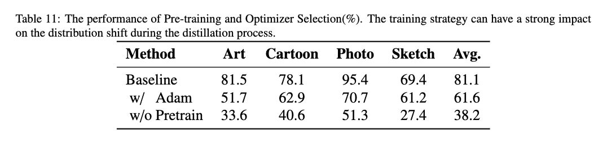

Tab. 11에서는 PACS의 Baseline 평균 정확도가 81.1%인 반면, Pre-training을 제거하면 38.2%로 감소한다.

그러나 Pre-training에서 학습한 Representation과 실제 Student Task에 필요한 Representation이 서로 다르면 효과가 제한적일 수 있다. 특히 PACS의 Photo와 Sketch처럼 Domain 특성이 다른 경우, Pre-training의 효과도 달라질 수 있다고 언급한다.

또한 Teacher가 Training Dataset의 Bias를 학습했다면, ColorMNIST의 색상과 숫자 관계처럼 이러한 Bias가 KD 과정에서 Student에게 전달될 수 있다.

따라서 Pre-training 자체보다 사전 학습된 Feature가 실제 Target Task에 얼마나 유용한지가 중요하다.

### SGD for KD on distribution shift, not Adam.
논문의 PACS 실험에서는 SGD를 사용한 Baseline의 평균 정확도가 81.1%인 반면, Adam을 사용하면 61.6%로 크게 감소한다.

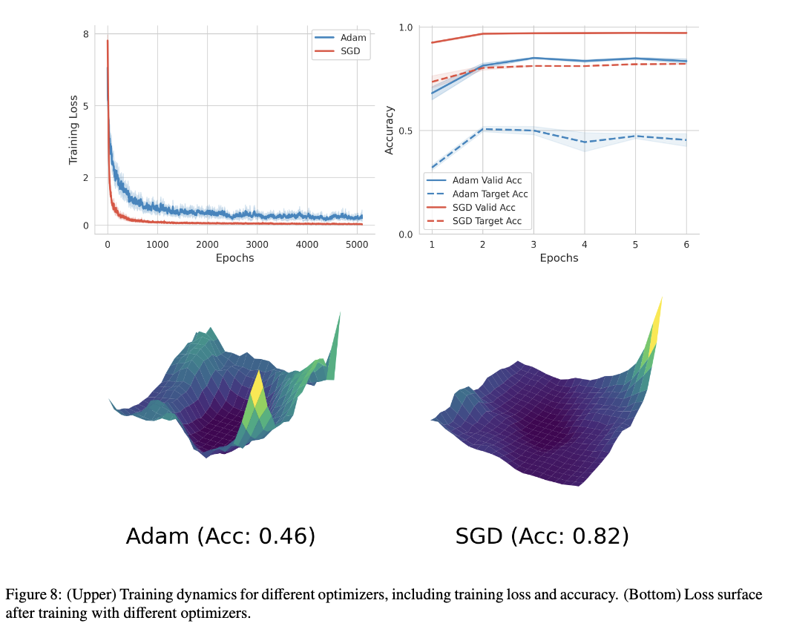

- Adam : 적절한 train loss + val, 그러나 테스트에서 급락
- SGD : Local minimum을 벗어나 비교적 평탄한 Flat Minima에 도달할 수 있다.

Adam은 Sharp Minima로 수렴할 수 있다고 설명한다. Sharp Minima는 주변 Loss Surface의 곡률이 크기 때문에 작은 Parameter 변화에도 Loss가 크게 증가할 수 있다. 저자들은 이러한 특성이 Distribution Shift에 대한 민감도를 높일 수 있으며, SGD의 확률적인 특성은 Local Optimum에서 벗어나 Flat Minima를 찾는 데 도움이 된다고 해석한다.

저자들은 Adam과 같은 Adaptive Optimizer가 Distribution Shift에 취약할 수 있다는 관찰을 Zou et al. (2023)의 결과와 연결한다. 다만 본 논문의 SGD–Adam 비교가 모든 Dataset과 설정에서 SGD의 우수성을 보장하는 것은 아니다.

### Results of other student architectures.
다른 Student Architecture의 경우 Domain과 Model Capacity에 따라 KD 효과가 다르다. Tab. 12에서 ResNet-18은 평균 +5.1%p 개선되었지만, WRN-16-2와 WRN-40-2는 각각 -0.7%p, -0.1%p를 기록한다.

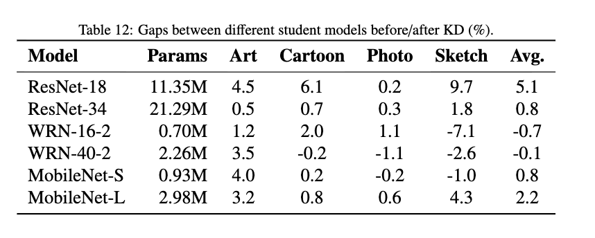
성능이 양수인 경우 KD 성능이 개선, 음수이면 오히려 감소한것

MobileNet은 ResNet보다 Parameter 수가 적어 복잡한 Knowledge를 충분히 표현하지 못할 수 있다. 따라서 저자들은 MobileNet의 경우 Knowledge Transfer를 위해 추가적인 조정과 Fine-tuning이 필요할 수 있다고 설명한다.

또한 KD의 효과는 Domain에 따라서도 달라진다. 저자들은 Art와 Cartoon의 Feature는 상대적으로 구별하기 쉬울 수 있지만, Photo나 Sketch의 Feature는 더 미묘하거나 복잡하여 Knowledge Transfer가 어려울 수 있다고 설명한다. 다만 모든 Student Architecture에서 이 경향이 동일하게 나타나는 것은 아니다.

### The role of calibration in student models under distribution shift.

낮은 ECE는 예측된 신뢰도와 실제 정확도가 더 잘 일치한다는 의미이며, 잘 보정된 모델은 다른 데이터 분포를 마주할 때 더 신뢰할 수 있다.

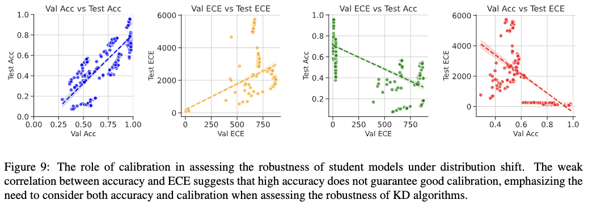
저자들은 본문에서 Accuracy와 ECE 사이에 강한 음의 상관관계가 나타났다고 보고한다. 즉, Accuracy가 높은 Model일수록 Calibration Error가 낮아지는 경향이 관찰되었다고 설명한다. 다만 Fig. 9의 Caption에서는 Accuracy와 ECE 사이의 상관관계가 약하다고 서술하므로, 본문과 Caption의 표현이 일치하지 않는다.
반면 Validation ECE와 Test Accuracy 사이의 상관관계는 약하게 나타났다.

이는 Training Domain의 Validation에서 Calibration이 좋은 Model이라도 Unseen Test Domain에서 높은 Accuracy를 보장하지 못한다는 것을 의미한다. 저자들은 이러한 차이가 Validation과 Test 사이의 Distribution Shift에서 비롯될 수 있다고 설명한다.

또한 ECE에는 Binning Strategy에 민감하고 값이 불연속적으로 변할 수 있다는 한계가 있다고 언급하였다. 따라서 저자들은 Distribution Shift 환경에서 KD를 평가할 때 Accuracy뿐 아니라 Calibration을 함께 고려해야 한다고 주장한다. 특히 Validation ECE만으로 Unseen Test Accuracy를 안정적으로 예측하기 어렵다는 점을 강조한다.


