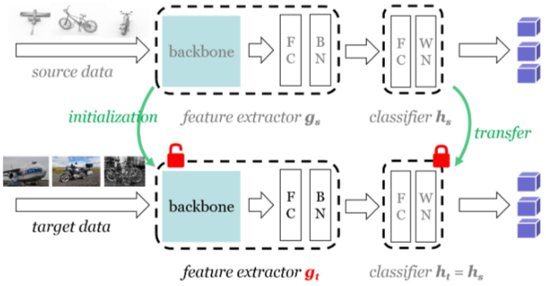
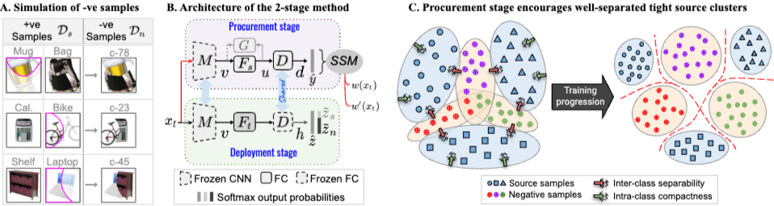
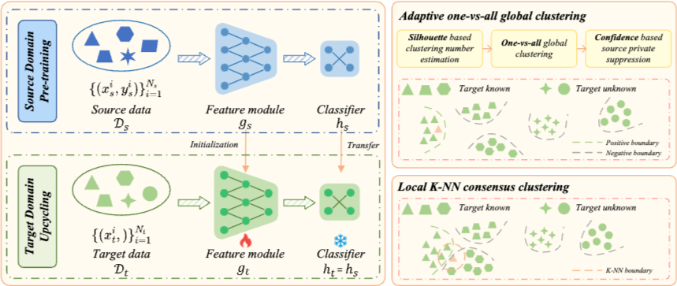
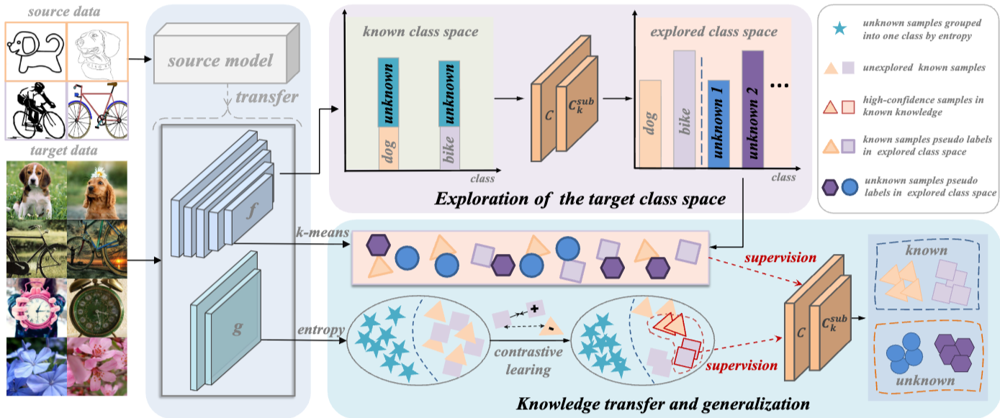
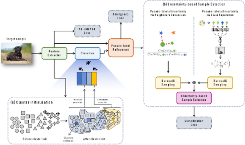
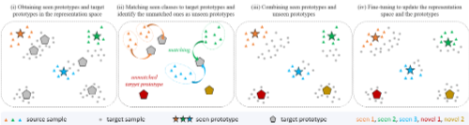
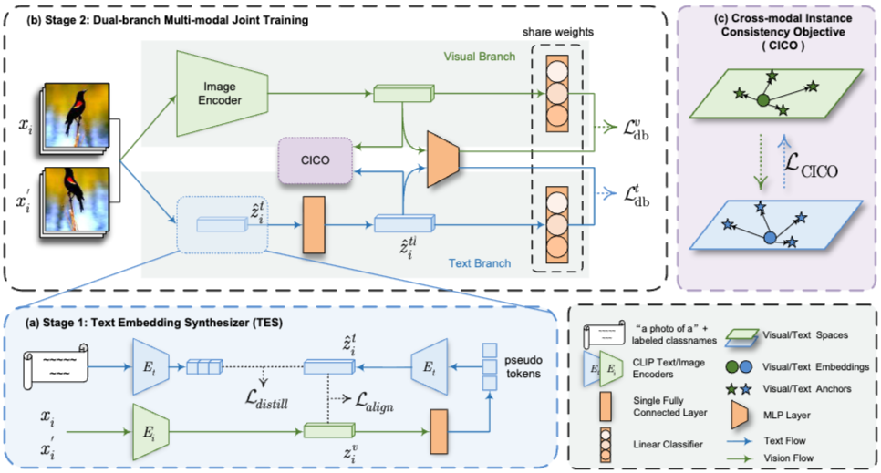
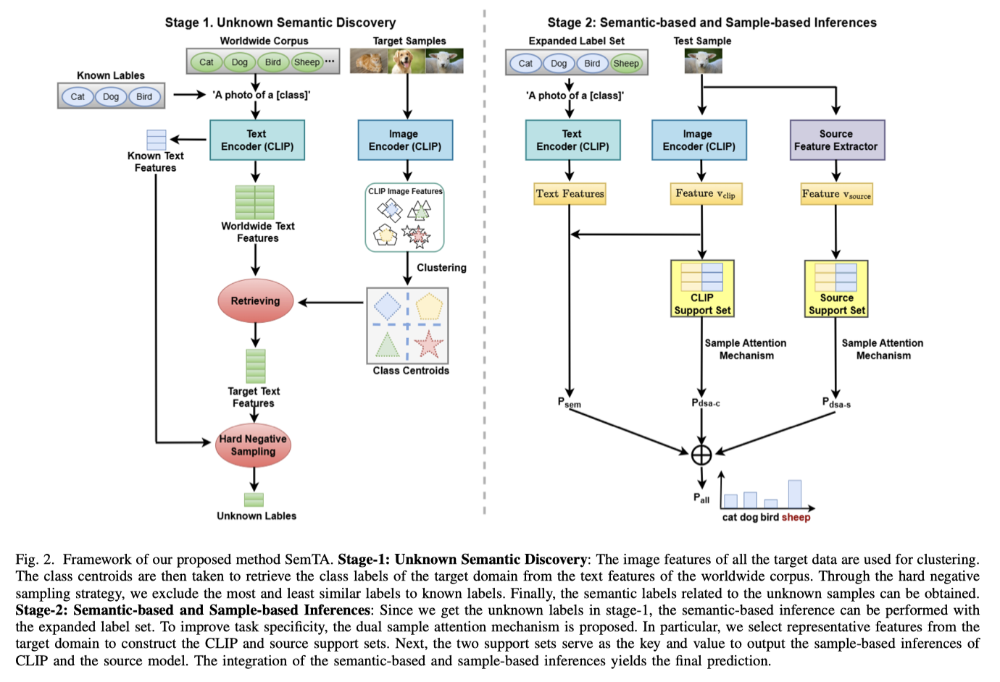

## 1. Source-Free DA, Unknown Detection

### 1. SHOT (ICML, 2020)

> <strong>Do We Really Need to Access the Source Data? Source Hypothesis Transfer for Unsupervised Domain Adaptation</strong>

<strong>Source 데이터 없이 기존의 Source clf.를 고정하고, Information Maximization, Self-Supervised Pseudo-Labeling으로 Target Feature Extractor를 적응</strong>시키는 SHOT을 제안

#### 1. 연구 배경 및 목적

Unsupervised Domain Adaptation(UDA)은 일반적으로 Source와 Target 데이터에 동시에 접근하여 두 분포를 정렬한다.

예를 들어
- Source : 사진
- Target : 스케치
→ 모델은 "사진에서 <strong>학습한 특징</strong>" $\approx$ "스케치에서 <strong>추출한 특징</strong>"이 되도록 학습

그러나 Source 데이터에 접근할 수 없으면 Source Feature의 실제 분포를 계산하기 어려워지고, 두 분포를 직접 비교하는 일반적인 Feature Alignment를 수행하기 어려워진다.

따라서 SHOT은 <strong>이미 학습된 Source clf. 자체가 Source 데이터의 클래스 구별 정보를 가지고 있으므로, 이 clf.를 기준으로 Target Feature를 적응</strong>시키자는 것

#### 2. 핵심 방법론

> 해당 논문의 Figure 2.

##### Source Hypothesis Transfer : Classifier 고정

모델의 구조를 Feature Extractor와 Classifier로 구분한다.

$$
f_S(x)=h_S(g_S(x))
$$

- $g_S$ : Source <strong>Feature Extractor</strong>
- $h_S$ : Source <strong>Classifier</strong>

SHOT에서는 Classifier $h_S$를 고정하고 <strong>Target 데이터로 Feature Extractor</strong> $g_T$<strong>만 Fine-Tuning</strong>

$$
f_T(x)=h_S(g_T(x))
$$

Source가 학습한 분류 기준을 바꾸지 않고 Target 데이터가 Source clf.의 기준에 적합한 Feature를 출력하도록 학습

##### Information Maximization (IM)

Label이 없는 Target이기 때문에 예측 확률의 구조를 이용한다.

$$
\mathcal L_{\mathrm{IM}} = \mathcal L_{\mathrm{ent}} + \mathcal L_{\mathrm{div}}
$$

<strong>Entropy Minimization</strong>

$$
\mathcal L_{\mathrm{ent}} =-\frac{1}{N}\sum_{i=1}^{N}\sum_{k=1}^{K} p_{ik}\log p_{ik}
$$

<strong>Diversity Regularization</strong>

$$
\mathcal L_{\mathrm{div}} =\sum_{k=1}^{K}\bar p_k\log\bar p_k
$$

$$
\bar p_k=\frac1N\sum_{i=1}^N p_{ik}
$$

- **Entropy Minimization :** 개별 <strong>Target 이미지가 특정 클래스로 명확하게 분류</strong>되도록 유도 → 개별 예측이 특정 클래스에 집중되도록 유도
- **Diversity Regularization :** 모든 <strong>Target 이미지가 하나의 클래스로 몰리는 현상을 억제</strong> → 전체 클래스 비율을 균등하게 유도
	- $\bar p_k$는 데이터에서 클래스 $k$에 할당한 평균 예측 확률

> **라벨의 분포도 모르는데 어떻게 Diversity Regularization의 평균 예측 확률을 만들까?**
>
> Target의 라벨 분포를 모르기 때문에 <strong>모델의 예측 분포가 균등분포에 가까워지도록 유도</strong> 
> → 이게 Label Shift와 같은 실제 클래스 비율이 불균형한 상황에서 Diversity Regularization이 성능을 떨어뜨릴 가능성이 있다.
{: .prompt-info }

##### Self-Supervised Pseudo-Labeling

Source clf.의 초기 예측이 Domain Shift 상황에서 부정확할 수 있기 때문에 Target Feature의 군집 구조를 활용한다. 이때 Source clf.의 정보를 통해 초기 Centroid들을 계산한다.

$$
c_k=
\frac{\sum_i p_{ik}g_T(x_i)}
{\sum_i p_{ik}}
$$

1. 각 Class에 대해 Target Feature의 Soft Label을 활용하여 Centroid를 계산
2. 각 데이터 포인트에서 Centroid까지의 Cosine Distance를 비교하여 의사 라벨을 지정하고 계속 보정

#### 3. Open Set

Unknown을 신규 클래스로 분류하지 않고, 해당 확장에서는 예측 entropy를 정규화한 뒤, 2-class k-means로 낮은 불확실성을 가지는 샘플과 높은 불확실성을 가지는 샘플로 구분. 높은 불확실성을 가지는 그룹은 Unknown으로 처리하고, 학습 중 일부 목적함수와 Centroid 업데이트에서 제외 → <strong>Unknown을 탐지하되 거부하는 방식</strong>

#### 4. 주요 결과 및 의의

<strong>Source 데이터에 접근하지 않고도 Source Classifier의 지식과 Target Feature 구조를 활용해 적응할 수 있음을 보여줌</strong> → SFDA의 시작점

### 2. Universal Source-Free Domain Adaptation (CVPR, 2020)

> <strong>Source 학습 시 Unknown에 대응할 수 있는 Generative clf.를 준비하고, Target에서는 Source Similarity Metric(SSM)으로 Known과 Unknown을 구별하면서 적응하는 USFDA(Universal Source-Free Domain Adaptation)를 제안.</strong>

#### 1. 연구 배경 및 목적

기존 UDA는 Source와 Target의 클래스 구성이 동일하거나, 집합 관계를 <strong>미리 알고 있다고 가정</strong>한다. 그러나 실제로는 Target 혹은 Source에 예상하지 못한 Class가 나타날 수 있다. 따라서 이 논문은
- <strong>Target Adaptation 과정에서 Source 데이터에 접근할 수 없다.</strong>
- <strong>Source와 Target의 클래스 구성 관계를 미리 알 수 없다.</strong>
라는 두 가지 제약을 고려한다. 특히 일반적인 Source clf.는 학습한 클래스만 구분할 수 있어 Unknown에 대한 사전 대비가 부족하다고 보고, Source 학습 단계부터 이를 준비하는 방법을 제안한다.

#### 2. 핵심 방법론

> 해당 논문의 Figure 4.

##### Stage 1. Procurement Stage : Source 모델 준비

Source 데이터를 사용할 수 있는 상황
- Source의 실제 클래스 : Positive Category 샘플
- Source 클래스의 이미지를 조합 : Negative Category 샘플 e.g. 서로 다른 두 클래스에서 가져온 이미지 영역을 조합 → <strong>실제 Target Unknown 데이터 X</strong>, 모델이 향후 경험할 수 있는 <strong>Out of Source 입력 대응</strong>을 위한 학습 신호

<strong>Generative Clf.</strong>
- Source Feature Space에서 class별 <strong>Gaussian Prior를 학습하여 Intra Class Compactness와 Inter Class Separability를 강화</strong>
- Decoder를 통한 복원으로 Feature Representation 정규화
- Negative Category 샘플을 학습하여 기존 Known 클래스에 대한 과도한 예측을 억제

##### Source Similarity Metric (SSM)

Target 데이터가 Source에 존재하는 class와 얼마나 유사한지 추정

$$
w(x_T)= \max_{k\in\mathcal Y_S} \exp\left(\hat p_k(x_T)\right)
$$

- $\hat p_k$ : Positive Category + Negative Category를 포함한 Source 모델에서 Known Class $k$에 할당한 확률
- $w(x_T)$ : 값이 높으면 Source Known Class일 확률이 높음

##### Stage 2. Deployment Stage : Source-Free Adaptation

Source 데이터를 사용하지 않는 상황

Procurement Stage에서 학습한 Source의 Feature 공간을 기준으로 Target 전용 Feature Extractor를 초기화하고 적응

Source Similarity Metric을 가중치로 사용해 Known과 유사한 Target Feature는 기존 Known Class 방향으로, 유사하지 않은 Feature는 Negative Category 방향으로 유도하며 Entropy를 최소화한 방향으로 학습

#### 3. 주요 결과 및 의의

<strong>Source-Free와 Universal DA를 결합하고, Target에서 Unknown에 대응하도록 Source 모델을 미리 학습시키는 전략</strong>

### 3. GLC : Upcycling Models Under Domain and Category Shift (CVPR, 2023)

> <strong>일반적인 Closed-Set Source 모델과 레이블 없는 Target 데이터만으로 Known/Unknown을 구별하고 적응하는 Global-Local Clustering(GLC)을 제안</strong>

#### 1. 연구 배경 및 목적

USFDA → 학습 단계에서 Unknown을 대비하는 구조 → 그러나 현실적으로 이미 학습된 일반적인 Closed-set 모델만 제공받는 경우가 많음

GLC는 <strong>Source 모델의 사전학습 방식을 변경하지 않고 Universal SFDA를 수행할 수 있는가</strong>라는 문제에 집중한다. Source와 Target의 클래스 집합이 다르면 일반적인 의사 라벨이 부정확해지는 점을 문제 삼는다. 예를 들어 <strong>Target의 모든 데이터를 Source Known Class에 강제로 할당하면 Unknown이 Known Class로 잘못 분류되는 Negative Transfer가 발생</strong>

#### 2. 핵심 방법론

> 해당 논문의 Figure 2.

##### Adaptive One-vs-All Global Clustering

기존 Clustering은 전체를 K개의 군집으로 나눈 다음 각 군집이 어떤 Class인지 해석해야 한다. 그러나 Source 데이터가 없기 때문에 각 Target 군집을 Source Class와 연결하기 어렵다.

GLC는 이를 <strong>클래스별 One-vs-All</strong> 문제로 나눈다. 각 샘플에 대해 Class 1인지 아닌지, Class 2인지 아닌지를 모든 Class에서 판단한다. 이때 높은 예측을 갖는 Target 샘플을 Positive Group으로 선택한다. 이 Positive Group의 평균 Feature를 Positive Prototype으로 설정하고, 나머지 Target Feature는 K-means로 여러 Negative Prototype을 구성한다.

이후 각 Target 샘플이 Positive, Negative 중 어디에 가까운지 비교해 의사 라벨을 생성하고, 어떠한 Known Class에도 해당하지 않는 샘플을 Unknown으로 처리한다.

##### Silhouette-Based Class Number Estimation

실제 Target Class 수를 모르기 때문에 <strong>실루엣 계수</strong>를 사용한다. Silhouette Score는 같은 군집 내부의 거리가 작고 다른 군집과의 거리가 멀수록 높은 값을 가지는 지표이다. 논문은 후보 클래스 수에 대해 Clustering을 수행하고 평균 Silhouette Score를 활용하여 적절한 Target 군집 수를 추정한다. 또한 Target 의사 라벨을 왜곡하지 않도록 <strong>Confidence-Based Source-Private Suppression</strong>을 적용한다.

> **Confidence-Based Source-Private Suppression**
>
> Target에 존재하지 않는 Source Class가 잘못된 의사 라벨을 생성하지 않도록 영향력을 줄이는 기법으로 각 Source Class의 Target 예측 확률 중 <strong>TopK 평균 Confidence</strong>를 계산하고, Confidence가 낮은 class의 Positive Prototype 유사도를 감소시키는 방법
{: .prompt-info }

##### Local k-NN Consensus Clustering

Global Clustering에서 생성한 의사 라벨도 Domain Shift 때문에 오류가 있을 수 있음. 따라서 GLC는 Target Feature와 예측을 Memory Bank에 저장하고, 각 샘플의 NN을 검색하여 샘플들의 평균 예측을 이용한 Local Consistency Loss를 계산한다.

$$
\mathcal L_{\mathrm{loc}} = -\frac1N\sum_{i=1}^N\sum_{c=1}^{C_S} l_c^{(i)}\log p_c(x_i)
$$

- $l_c^{(i)}$: 샘플 $i$의 이웃들이 클래스 $c$에 부여한 평균 예측 확률
- $p_c(x_i)$: 현재 모델이 샘플 $i$를 클래스 $c$로 예측한 확률
전용 Loss는 아래와 같다.

$$
\mathcal L_{\mathrm{GLC}}
=
\eta\mathcal L_{\mathrm{glb}}
+\mathcal L_{\mathrm{loc}}
$$

Global 항과 Local 항을 결합하여 샘플 하나의 예측만 신뢰하지 않고 유사한 샘플들과 일관된 예측을 하도록 학습

#### 3. 주요 결과 및 의의

<strong>Source를 별도로 재학습하지 않아도 Target의 군집 구조만으로 Universal Source-Free Adaptation을 수행할 수 있는 방법을 제시</strong>

Target 군집 수를 추정하지만, 최종 목적은 Known/Unknown 분리이다. 실제 추론에서는 정규화된 예측 Entropy가 Threshold를 초과하면 하나의 Unknown 범주로 처리하게 된다. <strong>Clustering을 사용한다는 것과 Unknown을 여러 개의 새로운 출력 클래스로 학습한다는 것은 다르다.</strong>

## 2. Unknown Class Discovery와 Classifier Expansion

### 4. UPUK : Unveiling the Unknown (CVPR, 2024)

#### Unveiling the Unknown: Unleashing the Power of Unknown to Known in Open-Set Source-Free Domain Adaptation (UPUK)

> <strong>Target의 Unknown 클래스를 하나의 범주로 처리하지 않고, Unknown Diffuser로 클래스 수를 추정하고 군집을 분리·병합하여 Known과 Unknown의 지식을 함께 학습하는 방법을 제안</strong>

#### 1. 연구 배경 및 목적

Open-Set SFDA는 $\{Known 1, Known 2, ..., Known K, Unknown\}$처럼 처리됨. 즉 Unknown에 속하는 모든 데이터가 하나의 범주로 묶이게 됨 e.g. 개, 자동차, 시계로 학습이 되었을 때 새로운 class가 등장하면 clf.는 모두 Unknown으로 처리

이러한 방식이 <strong>Unknown 데이터의 내부 구조를 활용하지 못하고, Feature Space의 구별 능력을 제한</strong>한다. 그래서 Known만 정확하게 구별하는 것이 아니라, Unknown 내부에서도 서로 다른 클래스 구조를 발견하는 방법을 제안

#### 2. 핵심 방법론

> 해당 논문의 Figure 2.

##### Unknown Diffuser : Target Class Space 탐색

일반적인 K-means에서는 군집 수 K를 미리 지정해야 하지만, 실제 Target에는 몇 개의 클래스가 존재하는지 알 수 없다. UPUK의 핵심 구성요소인 Unknown Diffuser는
- <strong>Split</strong> : 하나의 군집 안에 서로 다른 클래스가 섞여 있다면 분리
- <strong>Merge</strong> : 서로 다른 군집이 실제로는 같은 클래스라면 병합
하는 두 가지 판단을 위해 계층적 군집 구조와 군집 중심 사이의 거리를 활용하여, 군집 내부의 두 Sub-cluster가 서로 멀다면 분리 후보, 서로 다른 군집의 중심이 가깝다면 병합 후보로 고려한다.

이후 <strong>Metropolis-Hastings(M-H) 프레임워크</strong>를 이용하여 Split/Merge 결정을 수행하는데, M-H는 확률적 전이 과정을 통해 현재 상태에서 다른 상태로 이동할지 판단하는 방법이다. 이 논문에서는 군집 구성과 클래스 개수의 변화를 결정하는 데 활용된다. 즉 고정된 K로 Clustering하는 대신 군집 구조를 반복적으로 수정하여 Target Class Space를 탐색한다.

- 디퓨전 모델이 아니다.

> **Metropolis-Hastings(M-H)**
> 1. **Proposal :** 현재 상태에서 새로운 상태를 제안합니다.
> 2. **Acceptance Ratio :** 새로운 상태가 기존 상태에 비해 얼마나 적절한지 계산합니다.
> 3. **Accept / Reject :** 계산한 확률에 따라 새로운 상태를 받아들이거나 기존 상태를 유지합니다.
>
> $$
> \boxed{
> A(x,x') = \min\left( 1, \frac{\pi(x')q(x\mid x')} {\pi(x)q(x'\mid x)} \right)
> }
> $$
>
> - $x$: 현재 상태
> - $x'$: 제안된 새로운 상태
> - $\pi(x)$: 현재 상태의 목표 확률밀도
> - $q(x'\mid x)$: 현재 상태에서 새로운 상태를 제안할 확률
> - $A(x,x')$: 새로운 상태를 받아들일 확률
{: .prompt-info }

##### Cluster Assignment Learning

Unknown Diffuser가 군집 구조를 바꾼 뒤에는 새롭게 구성된 군집이 Feature Space에서 구별되도록 학습해야 한다. 이를 위해 K-means로 얻은 Teacher Cluster Distribution과 네트워크가 예측하는 Cluster Assignment 사이의 Alignment를 아래와 같이 수행한다.
1. Target Feature
2. Clustering
3. Cluster Assignment
4. Split / Merge
5. 반복

이 과정이 반복되면서 추정 클래스 수에 맞춰 업데이트되고, 단순히 Unknown을 구별하는 것뿐 아니라 <strong>새롭게 발견되는 클래스 개수에 따라 군집 분류 공간도 변경된다.</strong>

##### Known Knowledge Reliability 및 Collaborative Supervision

Unknown을 탐색하는 동안 기존 Source Known Class의 지식도 활용해야 한다. 이때 UPUK는 Source Classifier의 예측 Entropy가 낮은 Target 샘플의 상위 50%를 신뢰할 수 있는 Known 후보로 선택하고, 이 샘플들에 <strong>Contrastive Constraint를 적용</strong>하여 비슷한 Known 예측끼리는 가까워지고, 다른 예측끼리는 멀어지도록 한다.

이후 신뢰할 수 있는 Known 의사 라벨과 Unknown Diffuser가 발견한 군집 정보를 함께 사용해 학습하게 된다. 

$$
\mathcal L = \mathcal L_{\mathrm{kt}} + \mathcal L_{\mathrm{alg}}
$$

- $\mathcal L_{\mathrm{kt}}$: 신뢰도 높은 Known Pseudo-Label을 통한 Knowledge Transfer
- $\mathcal L_{\mathrm{alg}}$: 확장된 Target Class Space의 Cluster Assignment Alignment

즉, Unknown의 구조를 이용하여 Target Feature를 좀 더 세밀하게 구분하면서 기존 Known Class의 전이도 함께 개선하게 된다.

#### 3. 주요 결과 및 의의

<strong>따라서 Unknown Class의 수와 내부 군집 구조를 추정하지만, 실제 객체 이름을 자연어로 발견하는 연구는 아니다.</strong> 또한 Known 후보를 Source Classifier의 Entropy로 선택하기 때문에, 초기 Source 모델의 예측 정보가 학습 과정에서 계속 활용된다. 그러나 <strong>Source-Free 환경에서 Unknown Class Count Estimation과 새로운 클래스 공간 탐색 자체가 이미 연구되고 있다는 사실</strong>을 확인하는 것이 중요하다.

### 5. Uncertainty-guided Open-Set SFDA (IJCV, 2026)

#### Uncertainty-guided Open-Set Source-Free Unsupervised Domain Adaptation with Target-private Class Segregation

<strong>Source Classifier를 새로운 Unknown Class까지 확장하고, Target Clustering과 Uncertainty-Guided Pseudo-Labeling으로 Known 및 Unknown 클래스를 동시에 학습하는 SF-OSDA 방법을 제안</strong>

#### 1. 연구 배경 및 목적

기존의 Open-Set SFDA 방법들은 Unknown에 속하는 모든 샘플을 하나의 클래스로 처리하게 됨. 그러나 서로 다른 Unknown 클래스들이 하나의 출력 범주로 묶이면 Feature Space에서 의미가 다른 샘플들이 같은 그룹으로 모이도록 학습될 수 있다. 이러한 구조가 클래스 사이의 구별 능력을 손상시킬 수 있다고 보고, <strong>Target-Private 클래스들을 개별적으로 분류하도록 Classifier를 확장</strong>

또한 의사 라벨은 Domain Shift로 인해 Known 데이터가 Unknown으로 오분류되거나 그 역으로도 분류되면, 모델이 자신의 잘못된 예측을 반복 학습하는 Confirmation Bias가 발생한다.

#### 2. 핵심 방법론

> 해당 논문의 Figure 1.

##### Classifier Expansion 및 Clustering-Based Initialization

기존 Source Classifier는 $C_S$개의 Known Class만 분류할 수 있다. 따라서 Unknown을 추가로 구별할 수 있도록 확장이 필요하다.

$$
\boxed{ W_T=[W_S\mid W_P] }
$$

- $W_S$: 기존 Source Classifier Weight
- $W_P$: 새롭게 추가되는 Target-Private Classifier Weight
기존 Source Classifier를 그대로 복사하여 Known 부분을 초기화하고, 신규 출력 부분은 처음에는 무작위로 초기화

Unknown에 대해서는 무작위 Weight가 적절한 예측을 생성하기 어렵기 때문에 Source 모델에서 추출한 Target Feature 전체에 Clustering을 수행

$$
K=|C_S|+|\widehat C_P|
$$

- $|C_S|$: 기존 Known Class 개수
- $|\widehat C_P|$: 새로 추가할 것으로 가정한 Unknown Class 개수
- $K$: 전체 Target 군집 수
Source Classifier의 Weight를 Known Class Prototype으로 사용한다. 각 Source Prototype과 Target 군집 중심 사이의 Cosine 유사도를 계산한 뒤 서로 유사한 군집을 매칭한다.

<strong>매칭되지 않은 군집 중심을 Unknown Class Prototype으로 간주하고, 신규 Classifier Weight의 초기값으로 사용한다.</strong> 이렇게 하면 기존에 학습된 Known Class의 구별 기준을 보존하면서 Unknown을 별도의 출력 클래스로 학습할 수 있다.

##### Pseudo-Label Refinement 및 Uncertainty-Based Sample Selection

초기 Clustering으로 생성한 의사 라벨에도 오류가 있을 수 있다. 그렇기 때문에 NN(Nearest Neighbor)의 예측을 평균내는 <strong>Neighbours Consensus</strong>를 이용하여 의사 라벨을 정제한다.

$$
\bar p_t^{(c)}
=
\frac1{|\mathcal I|}
\sum_{i\in\mathcal I}p_i^{(c)}
$$

- $\mathcal I$ :  현재 Target 샘플의 이웃 집합

이웃들의 평균 예측이 가장 높은 클래스를 새로운 의사 라벨로 사용한다. 하지만 이웃들이 모두 같은 잘못된 라벨을 가지고 있다면 Consensus만으로 오류를 발견할 수 없기 때문에
- <strong>Neighbours Consensus Uncertainty</strong> : 주변 이웃들의 예측이 서로 얼마나 불일치하는지 측정
- <strong>Class Separation Uncertainty</strong> : 샘플이 가장 가능성이 높은 두 Class Prototype에 얼마나 비슷한 거리로 위치하는지 측정
위의 두 가지 Uncertainty를 함께 추정한다. 이 불확실성을 베르누이 분포 확률로 변환하여 신뢰도 높은 샘플 위주로 Classification Loss를 계산한다.

##### Negative Learning 및 NL-InfoNCE Loss

일반적인 Positive Learning은 의사 라벨이 개라면 해당 샘플이 개로 분류되도록 학습하는데, 만일 의사 라벨이 틀렸다면 오류가 강화된다. 따라서 Negative Learning을 사용하는데, 이는 <strong>반대로 특정 클래스가 아니라는 정보</strong>를 학습에 사용하게 된다. 즉 <strong>정답이 아닌 클래스의 무작위 라벨을 하나 가져와</strong> 해당 클래스의 예측 확률을 낮추도록 학습한다. 원 논문의 분류 손실 함수는 다음과 같다.

$$
\mathcal L_t^{cls} = -\mathbb E_{x_t\in\mathcal U} \left[ \sum_{c=1}^C \tilde y^c\log(1-p_{\mathrm{sa}}^c) \right]
$$

- $\mathcal U$: 불확실성이 낮아 선택된 Target 샘플
- $\tilde y$: 정제한 Pseudo-Label을 제외하고 선택한 Complementary Label
- $p_{\mathrm{sa}}$: Strong Augmentation을 적용한 샘플의 예측 확률

저자들은 Contrastive Learning에서도 Negative Learning을 적용한 NL-InfoNCE Loss를 제안한다. 일반적인 CL과는 다르게 여러 Epoch의 의사 라벨 기록을 이용해 잘못된 Negative Pair를 제외하고, NL-InfoNCE를 통해 남은 Negative Pair의 유사도를 낮추도록 하는 손실함수이다.

#### 3. 주요 결과 및 의의

<strong>일반적인 Known/Unknown Detection뿐 아니라, Unknown을 여러 신규 클래스로 구분하는 추가 실험까지 수행</strong>

## 3. Foundation Model 기반 Unknown Class Discovery

### 6. CROW : Cross-domain Open-world Discovery (ICML, 2024)

#### CROW: Cross-domain Robust Open-World Discovery

<strong>Foundation Model의 Feature Space에서 Target을 먼저 Clustering하고, 기존 Known Class와 군집을 매칭하여 새로운 클래스를 발견하는 CROW를 제안</strong>

#### 1. 연구 배경 및 목적

아래의 두 문제는 별도로 다룸

- Domain Adaptation : Source와 Target의 분포가 다른 문제를 해결
- Novel Class Discovery : 레이블 없는 데이터에서 기존에 학습하지 않은 클래스를 발견

현실에서는 Domain Shift 시에 새로운 클래스의 출현이 동시에 발생할 수 있음

이때 모델은 Domain Shift 때문에 개와 고양이를 잘못 분류하지 않아야 하며, 물고기와 거북이를 단순히 하나의 Unknown으로 묶지 않고 서로 다른 클래스로 발견해야 한다. CROW에서는 이를 <strong>Cross-Domain Open-world Discovery(CD-OWD)</strong>로 정의한다.

기존 방식은 Universal DA를 먼저 적용하고 Known/Unknown을 먼저 구분한 뒤, Unknown으로 판단된 데이터만 Clustering하는 방법도 생각할 수 있음

하지만 Domain Shift 때문에 Known 샘플이 Unknown으로 잘못 분류되면 Clustering 이후에도 오류가 전달되기 때문에, <strong>Clustering을 먼저 수행하고, Known Class와 매칭하는 순서를 이 프레임워크에서 제안한다.</strong>

#### 2. 핵심 방법론

> 해당 논문의 Figure 2.

##### Foundation Model 기반 Target Clustering

CLIP 등의 FM이 학습한 Feature Space를 활용하는데, 이는 일반적인 Source 모델은 Known Class를 구별하는데 특화되어 있지만, FM은 Feature를 더 다양한 시각적 개념으로 표현할 수 있기 때문이다.

Target 데이터를 Feature로 변환한 후 K-means를 수행한다.

$$
z_i^T=f_{\mathrm{FM}}(x_i^T)
$$

$$
\mathcal P_T=\{p_1^T,\ldots,p_K^T\}
$$

- $f_{\mathrm{FM}}$: Foundation Model의 Feature Extractor
- $z_i^T$: Target 이미지의 Feature
- $\mathcal P_T$: K-means로 추정한 Target Prototype

여기서 Prototype은 각 군집을 대표하는 Feature Vector이다. 기본 설명에서는 Target 클래스 개수를 사전 정보로 가정한다 ($K = |Y_T|$)

##### Cluster-Then-Match

Source의 라벨 데이터를 사용해 Known Class Prototype을 학습한다.

$$
\mathcal P_S=\{p_1^S,\ldots,p_{C_S}^S\}
$$

이제 Target 군집이 Source의 어떤 Known Class와 대응하는지 확인해야 한다.

예를 들어 Target을 Clustering한 결과 다음 군집을 얻었다고 가정하면

- Cluster 1: 개 스케치
- Cluster 2: 다른 형태의 개 스케치
- Cluster 3: 고양이 스케치
- Cluster 4: 물고기 스케치
- Cluster 5: 거북이 스케치

Cluster 1, 2는 실제로 같은 클래스일 수 있다. 따라서 CROW는 Source Class와 Target Cluster가 반드시 1:1로 대응한다고 가정하지 않는다. Source 샘플을 Target Prototype 중 가장 가까운 곳에 할당하고 그 결과로 Co-occurrence Matrix를 계산한다.

$$
\Gamma_{ij} = \#\{x\in\mathcal D_S: y(x)=j,\ \operatorname{NN}_{\mathcal P_T}(x)=i\}
$$

- $\Gamma_{ij}$: Source 클래스 $j$의 샘플 중 Target Prototype $i$에 가장 가깝게 할당된 샘플 수
- $\operatorname{NN}$: 가장 가까운 Prototype을 찾는 연산

이 행렬을 정규화해 Known Class와 Target Prototype의 대응 관계를 추정한다. 중요한 부분은 <strong>Many-to-Many Matching</strong>을 허용하여 하나의 Known Class가 여러 Target Prototype과 연결될 수 있고, 하나의 Target Prototype에 여러 Known Class가 연결될 수 있다. 이를 통해 오류가 발생하더라도 줄일 수 있다. 기존 Known Class와 매칭되지 않은 Target Prototype은 Novel Class Prototype으로 사용한다.

##### Prototype Expansion 및 Fine-Tuning

Known과 Novel Prototype을 합쳐서 새로운 분류 공간을 구성한다.

$$
W=[W_{\mathrm{seen}}\mid W_{\mathrm{unseen}}]
$$

이후 Source의 지도학습 Loss와 Target의 정규화 항을 함께 사용하여 Feature Space를 Fine-Tuning한다.

$$
\mathcal L_{\mathrm{CROW}}
=
\mathcal L_{\mathrm{source}}
+
\lambda\mathcal L_{\mathrm{reg}}
$$

여기서 Source Loss는 기존 Known Class의 분류 성능을 유지하는 역할을 한다. Target 정규화 항은 새로운 Target 클래스 공간에서 예측이 일부 클래스에만 집중되는 현상을 억제한다.

#### 3. 주요 결과 및 의의

<strong>FM의 Feature 공간을 이용해 Domain Shift가 있는 환경에서도 새로운 클래스를 발견하고, 기존 클래스와 통합된 분류 공간을 구성할 수 있다.</strong> 그러나 SFDA는 아니다. Source 데이터와 Target 데이터에 모두 접근이 가능하여야 하기 때문이다. 이 모델의 가장 큰 특징은 "<strong>FM을 활용하여 Visual Feature를 생성 및 이용</strong>"하는 것이다.

### 7. GET : Unlocking the Multi-modal Potential of CLIP for GCD (CVPR, 2025)

<strong>Unknown Class의 이름을 모르더라도 CLIP의 Text Embedding Space를 활용할 수 있도록, 이미지 Feature에서 Pseudo-Text Embedding을 생성하는 GET</strong>을 제안

#### 1. 연구 배경 및 목적

Generalized Category Discovery(GCD)는 Known과 Novel Class가 함께 존재하는 레이블 없는 데이터를 분류하는 문제로서 기존의 GCD는 DINO와 같은 Visual FM에서 추출한 정보를 활용한다. 그러나 <strong>Visual Feature만으로는 시각적으로 매우 비슷한 클래스를 구분하기 어려울 수 있다.</strong> 예를 들어 서로 다른 나무 종, 새 종처럼 형태가 비슷한 객체는 이미지의 색상, 배경, 촬영 방향 등에 따라 Feature가 비슷해질 수 있다.

반면 CLIP은 이미지와 자연어를 정렬하도록 학습되었으므로, 시각적 특징 이외의 언어적/의미적 정보를 활용할 가능성이 있으나, CLIP의 일반적인 분류 방식이 클래스의 이름이 필요하다는 것이다.

즉 Known Class는 이름을 알고 있지만 Novel Class는 이름을 모른다. 따라서 Unknown에 대해 적절한 Text Embedding을 직접 만들기 어렵다. <strong>그래서 실제 자연어 클래스 이름이 없어도 Text Embedding Space를 사용할 수 있는가</strong>라는 문제에 집중한다.

#### 2. 핵심 방법론

> 해당 논문의 Figure 2.

##### Text Embedding Synthesizer (TES)

TES는 이미지 Feature를 입력받아 CLIP Text Encoder에 전달할 수 있는 의사 토큰을 생성한다.

$$
z_i^v=E_I(x_i)
$$

$$
q_i=g_\phi(z_i^v)
$$

$$
\hat z_i^t=E_T(q_i)
$$

- $z_i^v$: 이미지의 Visual Embedding
- $g_\phi$: 학습 가능한 Fully Connected Mapping
- $q_i$: 이미지 Feature에서 변환한 Pseudo-Token
- $\hat z_i^t$: 생성된 Pseudo-Text Embedding

일반적인 CLIP과 다르게 GET은 이미지 Feature 자체로부터 Text Encoder가 처리할 수 있는 Token을 생성하여 새의 종류를 모르더라도 그 이미지에 대응하는 Pseudo-Text Embedding을 만들 수 있음

$$
\mathcal L_{\mathrm{TES}}
=
\mathcal L_{\mathrm{align}}
+
\mathcal L_{\mathrm{distill}}
$$

- <strong>Alignment Loss</strong> : 생성한 Text와 Visual Embedding 간의 대응 관계를 학습
- <strong>Distillation Loss</strong> : Known Class의 실제 클래스 이름으로 생성한 Text Embedding을 Teacher의 학습 신호로 사용

##### Dual-Branch Multi-modal Joint Training

TES가 Pseudo-Text Embedding을 생성한 다음에는 이를 Category Discovery에 활용한다. 두 학습 Branch를 구성하는데,
- <strong>Visual Branch</strong> : CLIP Image encoder의 Visual Feature을 활용
- <strong>Text Branch</strong> : TES로 생성한 의사 텍스트 임베딩을 활용
각각의 Clf.를 학습하며, Known Class의 정답 레이블과 레이블이 없는 데이터의 Self-Distillation 정보를 활용함. Visual은 시각적 구별 능력을 학습하고, Text는 그에 대응하는 언어적 표현 공간의 구별 능력을 학습하여 분류 성능을 개선한다.

##### Cross-modal Instance Consistency Objective (CICO)

두 Branch가 존재한다고 해서 Feature Space의 구조가 자동으로 일치하지는 않는다. 따라서 CICO는 두 공간에서 샘플 사이의 관계가 일관되도록 학습하는데, Known Class에서 얻은 Anchor를 이용해 각 샘플이 다른 샘플과 어떤 관계를 가지는지 측정하고, 그 관계가 Visual/Text Space에서 비슷하도록 유도한다. <strong>단순히 두 Embedding의 위치만 맞추는 것이 아니라, 주변 샘플과의 관계 구조도 일치시키는 접근</strong>이다. 이 과정을 통해 Visual과 Pseudo-Text 표현이 서로 보완하도록 학습된다.

#### 3. 중요 사항

학습 과정에서 Known Class의 라벨 데이터에 접근하며, Novel Class의 개수도 기본 설정에서 알고 있거나 별도의 방법으로 추정한다고 가정한다. 또한 TES는 사람이 읽을 수 있는 자연어 클래스 이름으로 만드는 것이 아니다. 즉 <strong>이미지를 구별하는 데 도움이 되는 Text Feature Representation</strong>을 생성한다.

### 8. Training-Free Open-Set DA with Vision-Language Models (IEEE TIP, 2026)

<strong>CLIP과 WordNet을 이용해 Unknown Class의 의미적 레이블을 발견하고, Source 모델과 CLIP의 Feature를 결합하여 추가 학습 없이 Source-Free Open-Set Domain Adaptation을 수행하는 SemTA를 제안</strong>

#### 1. 연구 배경 및 목적

OSDA에서는 Source에 없는 Unknown class를 발견하기 위해 예측 Confidence나 Feature Distance에 Threshold를 적용한다 그러나 아래의 2가지 문제가 있다
- Unknown Semantic Information 부재 : Unknown을 하나의 범주로 거부할 뿐, 서로 다른 Unknown Class의 실제 의미를 파악하지 못함
- Threshold Dependency : Known과 Unknown의 Feature가 비슷하거나 Unknown에 대한 예측 Confidence가 높다면 정확하게 구별하기 어려움

CLIP과 같은 VLM은 기본적으로 텍스트와 이미지의 의미적 관계를 활용해 zero shot을 진행할 수 있으나, 기본적으로 분류할 클래스의 이름이 필요하다. 따라서 Unknown Class의 이름을 모르는 OSDA에서 바로 사용하기 어렵다.

따라서 저자들은 <strong>Target 이미지에서 Unknown Class의 Semantic Label을 자동으로 발견하고, CLIP의 일반적인 지식과 Source 모델의 Task-Specific Knowledge를 결합</strong>하는 방법을 제안한다. 특히 Source 데이터를 사용하지 않고, 모델 파라미터도 업데이트하지 않는 Source-Free 및 Training-Free 환경을 목표로 한다.

#### 2. 핵심 방법론 

> 해당 논문의 Figure 2.

##### Unknown Semantic Discovery (USD)

<strong>Target 이미지의 Feature를 군집화하고, WordNet에서 해당 군집과 의미적으로 유사한 클래스 이름을 검색하는 방법</strong>으로 WordNet에 있는 명사와 형용사를 추출한 뒤 CLIP Text Encoder로 변환하여 Text Embedding 집합을 구성

$$
\mathcal Z_{\mathrm{ind}} = \{f_t(e)\mid e\in\mathcal E_{\mathrm{ind}}\}
$$

- $\mathcal E_{\mathrm{ind}}$: WordNet에서 추출한 단어 집합
- $f_t$: CLIP Text Encoder
- $\mathcal Z_{\mathrm{ind}}$: 검색 가능한 Semantic Embedding 집합
다음으로 모든 Target 이미지를 CLIP Image Encoder로 변환하고 K-means Clustering을 수행한다. 이때 Target Class 개수를 모르므로 Silhouette Score를 활용한다. 효율성과 안정성을 위해 t-SNE 기반 2차원 표현을 군집화에 사용한다.

$$
\hat K=\arg\max_{k\in\mathcal K}S_k
$$

$$
\mathcal K=\{1,2,3,5,10\}\times|\mathcal C_S|
$$

이후 Target 군집의 Centroid와 WordNet의 Text Embedding 사이에서 Cosine Similarity를 계산한다.

$$
\mathcal Z_{\mathrm{all}} = \bigcup_{i=1}^{\hat K} \arg\max_{z\in\mathcal Z_{\mathrm{ind}}} \operatorname{cos}(z,\mu_i)
$$

- $\mu_i$ : Target 군집을 대표하는 Centroid
예를 들어 Target 이미지들이 양의 형태를 가진 군집을 구성한다면, 해당 Centroid와 의미적으로 가까운 양 등의 단어를 검색하는 방식이다. 그러나 기존 검색 결과에는 Known Class와 관련된 단어도 포함될 수 있다. 따라서 <strong>Hard Negative Sampling</strong>을 통해 가장 유사한 후보와 가장 유사하지 않은 후보를 제외한 후 남은 후보를 Unknown Semantic Label로 사용하고 기존 Known Label과 결합한다.

$$
Z_{\mathrm{tar}}=[Z_{\mathrm{kn}},Z_{\mathrm{un}}]
$$

이를 통해 CLIP은 기존 Known Class뿐만 아니라 새롭게 발견한 Unknown Class에 대해서도 Zero-Shot이 가능하다.

<strong>핵심은 Clf.를 새로 학습하는 것이 아니라 CLIP이 비교할 Semantic Label Set을 확장한다는 점이다.</strong>

##### Dual Sample Attention (DSA)

<strong>CLIP의 Semantic Knowledge와 Source 모델의 Task-Specific Knowledge를 결합하여 Target에 적합한 예측을 생성</strong>

USD를 통해 Unknown Class의 이름을 발견하더라도 CLIP의 Zero-Shot이 반드시 정확한 것은 아니다. CLIP은 일반적인 정보는 가지고 있지만, 실제 Target 데이터의 Feature Distribution을 충분히 반영하지 못할 수 있다. 반면 Source는 Known Class에 특화된 정보를 가지고 있다.

이를 보완하기 위해 DSA는 두 모델에서 클래스별 Confidence가 높은 Target 샘플을 선택하여 <strong>Support Set</strong>을 구성한다. 논문에서는 클래스당 5개의 Feature를 선택하고, 새로운 Target 이미지의 Feature를 Query로 사용하고 Support Set의 Feature를 Key와 Value로 사용하여 유사도를 계산한다.

$$
\varphi(s)=\exp[-\beta(1-s)]
$$

- $s$: Query와 Support Feature의 유사도
- $\beta$: 유사도가 높은 Feature에 집중하는 정도
유사도가 높은 대표 Feature에 더 큰 가중치를 부여하여 현재 이미지에 맞는 Sample-Based Clf.를 동적으로 생성한다. 이를 CLIP과 Source 모델에 각각 적용해서 두 가지 예측을 얻는다.

$$
P_{\mathrm{dsa-c}} = \operatorname{Softmax} (f_v(x)(h^{\mathrm{clip}})^\top)
$$

$$
P_{\mathrm{dsa-s}} = \operatorname{Softmax} (f_s(x)(h^s)^\top)
$$

- $P_{\mathrm{dsa-c}}$: CLIP의 Target Feature 관계를 이용한 예측
- $P_{\mathrm{dsa-s}}$: Source 모델의 Target Feature 관계를 이용한 예측
Source 모델은 Unknown Class에 대한 출력을 가지고 있지 않으므로, Unknown 클래스의 대표 샘플 선정에는 CLIP의 결과를 사용한다. 이 과정에서 모델 파라미터를 학습하지 않고 <strong>Target 대표 Feature를 이용해 입력 샘플마다 다른 분류 기준을 구성한다.</strong>

##### Semantic-based / Sample-based Inference Integration

$$
\boxed{
P_{\mathrm{all}} = P_{\mathrm{sem}} + \alpha_1P_{\mathrm{dsa-c}} + \alpha_2P_{\mathrm{dsa-s}}
}
$$

- $P_{\mathrm{sem}}$: 발견한 Semantic Label을 활용한 CLIP Zero-Shot 예측
- $P_{\mathrm{dsa-c}}$: CLIP Feature의 Target 분포를 반영한 예측
- $P_{\mathrm{dsa-s}}$: Source 모델의 Known Class 지식을 반영한 예측

<strong>Semantic Information으로 Unknown을 발견하고, Target Feature와 Source Knowledge로 최종 분류를 보정하는 구조</strong>이다.

내부적으로는 Unknown 클래스를 여러 클래스로 구별하지만, 기존 방법과 비교할 때는 모든 Unknown 예측을 하나의 Unknown 범주로 통합하여 평가한다.

#### 3. 주요 결과 및 의의

<strong>기존 OSDA가 Unknown을 하나의 클래스로 거부하던 문제를 확장하여, Source 데이터나 추가 학습 없이도 Unknown의 의미적 레이블을 발견하고 분류에 활용할 수 있음을 보여줌</strong>